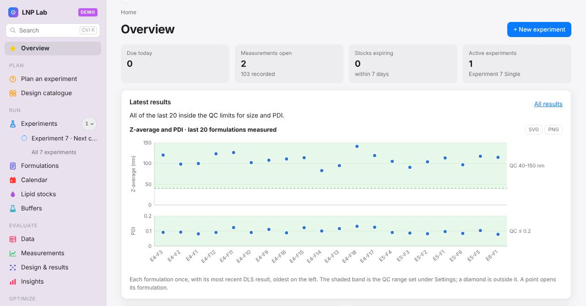
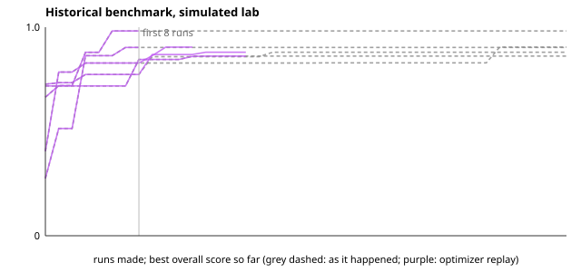

# LNP Lab

Local-first tool for LNP formulation planning, process design, evaluation and data management.
Plain HTML and ES modules, no build step: it runs in any modern browser from a small local server, and the same files
are built into a desktop app for macOS and Windows with Tauri (see Get it, below, and `docs/MACOS.md`). Single user; your records stay on your
computer.

- **Feedback:** the 💬 Feedback button at the foot of the sidebar (or under Settings) opens a pre-filled issue on
  [GitHub](https://github.com/xwinter134/LNP-Lab-Public/issues); or open one yourself.

- **Using it:** [docs/GUIDE.md](docs/GUIDE.md), the user guide, from the first start to an optimizer round
- **Maintaining it:** [docs/HANDOVER.md](docs/HANDOVER.md): architecture, running and updating, tests, data safety, open items
- **What changed:** [CHANGELOG.md](CHANGELOG.md), version by version
- **Bringing in old data:** [docs/HISTORICAL-DATA.md](docs/HISTORICAL-DATA.md) (tidy tables, checked by the app's
  rules) and, optionally, through Claude: [mcp/README.md](mcp/README.md)
- **Methods, licences and patents:** [NOTICE.md](NOTICE.md), [docs/LICENSE-CHECK.md](docs/LICENSE-CHECK.md)



## Get it

Download from [Releases](https://github.com/xwinter134/LNP-Lab-Public/releases/latest), then press **Try the demo
lab** on the first screen.

- **macOS** (Apple Silicon and Intel): the `.dmg`. Open it and drag LNP Lab to Applications. The first time,
  right-click the app › **Open** › **Open** (it is not notarised by Apple).
- **Windows 10 and 11** (64-bit): the `_x64-setup.exe`. It installs for your user, no administrator rights needed.
  If SmartScreen says it protected your PC: **More info** › **Run anyway** (the installer is not code-signed).
- **In the browser** (any system, Linux too): see Run, below.

## Run

Needs [Node.js](https://nodejs.org) (the LTS build) and nothing else; there is nothing to install.

```bash
git clone https://github.com/xwinter134/LNP-Lab-Public.git
cd LNP-Lab-Public
npm start          # then open http://localhost:8787
```

The commands:

```bash
npm start          # serves the app at http://localhost:8787
npm test           # node --test: calculation modules against values worked out by hand
npm run smoke      # Playwright: opens every screen and runs end-to-end scenarios (needs Chromium)
npm run scale      # Playwright: seeds 6 months of a busy lab and fails if a screen takes over 800 ms to open
                   # (npm run scale -- --months 12 --budget 800)
npm run campaign   # the optimizer against a simulated lab with a known optimum (npm run campaign -- --seeds 30 --rounds 6)
npm run history    # replays a finished campaign: would the optimizer have found its best recipe sooner?
                   # (npm run history -- --db lnp-lab.db --campaign E3,E4,E5, or --sim for the simulated lab)
```

The replay on the simulated lab (`docs/history-benchmark.md`; not real data): the best score so far, in the order
the runs were made and in the order the optimizer would have asked for them.



Tools around the app (each checks with the app's own code, none writes into your lab without you):

```bash
node scripts/import-tidy.mjs <folder> --db <lnp-lab.db>   # old data as three CSV tables -> report, quarantine, import file
node scripts/migration-check.mjs <lnp-lab.db>             # runs the schema update on a COPY of a database and checks nothing is lost
```

**The macOS app** (records in a SQLite file): `./scripts/build-mac.sh` on a Mac with Xcode and Node builds
`LNP Lab.app` and a `.dmg` to send; see `docs/MACOS.md`.

**On a Mac, without the terminal:** double-click `Start LNP Lab.command` in Finder. It pulls whatever has
been pushed since last time, starts the server and opens the browser. Leave the Terminal window it opens
alone while you work; closing it stops the app. The first double-click may need a right-click and "Open"
instead, because macOS asks once before running a script it has not seen.


Open `http://localhost:8787/` in a browser. Opening `index.html` from the file system does not work in Chrome, because ES modules and JSON loading need an http origin.

`npm start` runs `scripts/serve.mjs`, a small server that sends no-cache headers, so a `git pull` is picked up on the
next reload (a plain `python3 -m http.server` lets browsers keep old modules for days, which mixes versions after a
pull and leaves a blank page). After pulling, reload; the sidebar footer (wide window) ends with the running version,
which matches `version` in `package.json` of the current `main`. If the page stays blank, after three seconds it lists
the broken file and what to do.

## What it does

| Screen | What you do there |
|---|---|
| Overview | Due today, needs attention (expiring stocks, QC flags, unassigned imports, overdue), a chart of the latest results against the QC limits, recent formulations, and a reminder to export a backup when the last one is a week old and there is something new since. A search box above the sidebar (Ctrl/⌘ K) finds any experiment, formulation, sample name, stock, buffer, RNA lot or composition |
| Experiments | Choose the type first (single, stability, OFAT, DoE, comparison, reference); the app creates the formulations, the measurements they are due, their sample names and the calendar entries. Detail view with composition, N/P, progress, a "next step" strip (make, measure, evaluate), a printable notebook report (plan, data, statistics, figures), bench actions for every formulation at once (mark produced, set the lipid stock or RNA lot), and a Results card in the GraphPad sense: a data table with mean ± SD (n) and CV, plain-language statistics by experiment type (batch-to-batch CV for repeats, difference from the first arm for a comparison, for stability one table with the days as columns, a slope per shelf with its 95 % CI and the day it would reach the QC limit; Welch t or one-way ANOVA between arms once each has two batches), and figures (bars with SD and every run, size over time), each saved as SVG or PNG, the table as CSV |
| Formulations | Every formulation under the experiment that planned it, grouped and folded by experiment and shown a page at a time, with a filter for what is still to make or waiting for results. One record per formulation, opening on an "At the bench" card with the volumes and pump flows to set, then the step the batch is at; the other steps fold to a line saying where they stand: RNA dilution, mixing (pumps, FRR, quench, primary product concentration), dialysis, TFF, two-step final formulation, fill & finish; targets beside actuals; printable worksheet. Each formulation is either **quick** (mixing only: enter the volume to make, the mRNA, phases and pump flows follow) or the **full process**, and carries its process (device, mixer, quench, buffers with pH and ionic strength, downstream steps), drawn as a schematic and set in the experiment wizard. "Finish formulation" at the bottom marks it produced and leads on to the next one. **Process conditions** record what the process designer does not (ethanol share, temperature at mixing, cryoprotectant, final RNA concentration) and show what it does, and every record says where it came from (typed in, instrument file, imported tables) |
| Lipid stocks | Composition number → weigh-in in grams (mmol × MW, taken at face value: no correction for supplier purity) → actual weights → ethanol to add; stock lots; worksheet |
| Buffers | System, pH, concentration, volume → grams of reagents (pH solver with activity correction); a shelf of standard recipes with codes (CIT50, ACE25, PBS1X …). Lots are named by code, pH and date (`CIT50-pH4.0-20261031`) and keep a `Buffer-001` number for older records; the list is one row per buffer, opening into its lots, with tabs by role (Loading, Quench, Dialysis / TFF, Final / Storage) |
| Data | Every formulation in one place, filtered like a shop: facets with counts (lipids by class and PEG-free, buffer, pH, mixer, downstream, cargo, experiment, period, operator, source, what was measured, size and PDI ranges) and free text through the search. The selection's numbers (median size, PDI, EE), a sortable table with columns to choose, distributions whose bars filter, and how complete each field is. Every filter is in the address; the selection goes to the optimizer, to CSV or XLSX, or into a named view in the sidebar, and two views can be compared |
| Measurements | Opens on what is due: overdue, today and coming, grouped by experiment, each with the sample names to put on the instrument and a blank sheet carrying a column for every test still due (size, PDI, zeta, EE, RNA content; one sheet imports them all at once), or typed straight in as a grid (Tab goes down a column, a column pasted from Excel fills down; up to three DLS runs per sample). Then import: an instrument export as it comes (UTF-16 or UTF-8, English or German column names, metadata lines above the header, summary rows) or a block pasted out of a spreadsheet (comma, semicolon or tab; decimal commas read) of DLS, zeta, RiboGreen EE (or total and free RNA, µg/mL converted) or RNA content, recognised by its columns; triplicates averaged, rows matched to the expected measurements by sample name, a preview before anything is stored, and an inbox for rows that matched nothing. Manual entry per stage or timepoint, QC flags. A value no measurement can have (PDI outside 0–1, EE outside 0–100 %, a negative size or concentration) is refused wherever it is entered, with the reason. Every import ends in its own evaluation: what came in, Z-average and PDI per sample with the runs and the QC limits, size against PDI, which samples need a look and why, and where each experiment it fed now stands; recent imports reopen theirs. The preview names the expected samples missing from the file and fills in a lone unmatched row by elimination. The results stored so far are listed underneath, filtered and a page at a time. A stored result can be corrected with a reason; its earlier values stay in its history |
| Calendar | Generated events (production days, timepoints, buffer prep, stock expiry), manual events, .ics export, reminders |
| Design & results | The design wizard builds process designs (full factorial, CCD, Box-Behnken, Plackett-Burman; a factor on a lipid's mol% has cholesterol absorb the change, so every recipe totals 100), lipid blends (simplex-lattice, centroid, extreme vertices, D-optimal) or both crossed; runs become formulations. The screen leads with the conclusion: one recommended setting that balances every response (desirability, with the predicted values and a warning when it sits on the edge of the ranges run), then a sentence per response on what drives it, then one sentence on whether to believe the fit (a run that stands out, lack of fit against the replicates, too many terms for the runs, a funnel or a curve in the residuals, residuals that are not normal) beside the one plot that shows it, with the other diagnostic plots folded under it (each saved as SVG or PNG); the run table, the coefficients with p-values, the one-response optimum and the CSV exports are folded underneath. OFAT dose response |
| Plan an experiment | Opens on three doors: answer three questions, browse the catalogue, or start from a symptom. The guided door asks what you are trying to do, how many batches you have and what you may change, then recommends a design with the reasoning attached: why this and not something else, what will happen, what usually goes wrong, and what it knows about your own records. A separate path works backwards from a symptom to ordered causes with the check that settles each. See [docs/LEARN.md](docs/LEARN.md) |
| Design catalogue | Every option the app can set up, grouped by the question it answers: a first batch and a noise check, screening designs, response surfaces, model-led rounds, a stability study. The batch count for each is computed at the factor count you pick, from the same generator the wizard uses, and every entry hands itself over with its design already chosen |
| Reference | 32 condensed entries on formulation, process, measurement, design and modelling: what it is, why it matters here, the numbers worth knowing, what to do at the bench, and the trap. They open from a `?` beside the term on every screen, and are browsable and searchable in one place |
| Optimizer (optional) | Opens on **Data used**: every experiment it reads, the formulations each gives and the results they carry, every formulation left out and why (no result for a goal, a factor not recorded, a setting outside the limits it works in, an experiment you switched off), with a tick per experiment to leave one out; the header says "fitted on N formulations from M experiments". Fits a surface model per response from those formulations, reports how far it can be trusted (held-out Q², rank correlation, a shuffled-data null check, a predict-the-average baseline), proposes the next runs with their odds of beating the best so far, and turns them into planned formulations. See [docs/ML.md](docs/ML.md) After a run the screen leads with what to run next; the model report, the map and the method fold away under a line that says what they found Above it, a **Data and model** panel: one ionizable lipid and one mixer type at a time (or a selection handed over from Data), a data budget above 400 runs, the mode (one model per lipid, a lipid kernel that lets lipids learn from each other, or chosen by cross-validation), why each formulation is in or out, and a fingerprint that lets **Reproduce** repeat any round exactly; a fold compares predictions with what was measured |
| Insights | Leads with what it found in a sentence or three (the largest lot or operator effect against the batch-to-batch SD, drift in the latest batches, points outside the limits). Then an explorer: any result (size, PDI, EE, zeta, RNA content, size drift) against any parameter (FRR, flow, N/P, mol%, buffer pH and ionic strength, volume, the date, every lot, composition, operator, device, mixer, weekday, any other field on the records, your own custom parameters), drawn as a scatter with its trend line, a strip per group with mean ± SD, or a time series, chosen from what you pick, with a sentence and a group-by-group table (mean ± SD, n, difference from the others, Welch t or one-way ANOVA). A correlation map of every parameter against every result, the control chart over time with ±2 sd limits and process capability (Cpk) against the QC limits in Settings, **custom parameters** you define (a lipid mix number, a room temperature) and fill in per formulation or for a whole experiment at once, and a CSV of every formulation with all of it |
| Materials & lots | Lipids and lots, the composition registry (add and edit your own recipes here), RNA lots, buffer catalogue, formulation devices, TFF modules, dialysis devices, consumables; rows open in place for editing. Anything in use that cannot be deleted can be archived: hidden from lists and pickers, kept for the records that use it, restored under **Archived** |
| Studies (optional) | With a biological layer switched on (in vitro, in vivo potency, biodistribution, cell tropism): studies with groups, a reference formulation and controls; values typed, from a plate reader export, or from IVIS images (mice found on the photograph, total flux and a liver region per mouse, every value checkable and correctable); results normalised to the reference (log10 fold), tested against it with the effect size always shown, organ ratios, tropism shares, and physicochemistry against the biological signal across studies. Each layer also shows as a tab on formulations and experiments |
| Quarantine | Appears only while rows of an import wait there: open one, correct it, check it again with the same rules |
| Settings & export | Operator, defaults, QC thresholds, JSON export/import, recently deleted records to restore (every delete can also be undone from its notice), the list of imports with **Undo import**, and the switches for the optional parts (results grid, troubleshooting assistant, optimizer budget and descriptor mode, import with Claude, Claude insights in a personal build), all off by default |

Every screen shows a trail under its title (Plan › Plan an experiment › Questions …) with a Back arrow; Cmd+[ and
Cmd+] go back and forward. The sidebar is the workflow in order (plan, run, evaluate, optimize), and every screen
shows all its fields (there is no simple and advanced view since 0.15). Appearance follows the system
(light/dark) or can be fixed in the sidebar.

Experiments are numbered 1, 2, 3 (a number once used is never given out again, so a deleted experiment's kept results cannot attach to a new one) …, and each formulation is numbered inside the experiment that planned it, so
`E3-F2` is the second formulation of experiment 3 and its DLS export is matched by the name `E3-F2_final`.
Nothing else is encoded in an id: what a formulation was made from is on its record. Lipid stocks are materials
rather than formulations and get their own plain series, `Stock-001`. Buffer lots are named by code, pH and date,
because that is what is written on the bottle, and keep a `Buffer-001` number as their record id. A store
written by an earlier version is renamed to this scheme on first load, references and sample names included.

## Layout

```
index.html            shell: sidebar, simple/advanced toggle
app/main.js           hash router, screen loader
app/store.js          local JSON store (swap for SQLite in the macOS app)
app/schema.js         record types, the numbering scheme, sample-name parser, reference data loader
app/migrate.js        brings a store written by an earlier version up to date (numbering, provenance, process
                      fields), keeping a copy of every record first
app/refdata.js        reference data merged with the user's records, settings defaults
app/calc/             pure calculation modules (no DOM): lipid_stock, batch_record, buffer, mixture,
                      experiment, doe, diagnostics, parsers, qc, stats, ics, evaluate (an import's
                      evaluation), results (an experiment's data table and statistics), balance (one
                      setting that balances every response of a design)
app/ui/               one module per screen, each exports render(el, ctx); kit.js shared helpers;
                      charts.js result charts with SVG/PNG export, importeval.js and resultsview.js the
                      evaluation and Results cards
app/data/             reference data shipped with the app: lipids, published compositions, buffers, pKa (JSON)
scripts/              serve.mjs (dev server), dist.mjs (Tauri bundle), import-tidy.mjs (old data as tables),
                      migration-check.mjs (schema update on a copy of a database)
src-tauri/            macOS wrapper (Tauri 2)
tests/                node tests (calc, experiment, parsers), smoke.mjs + scenarios.mjs (browser),
                      usability/ (a scripted lab session against a simulated lab)
app/learn/topics.js   the reference content: 32 entries behind every "?" in the app
app/calc/designs.js   the design catalogue: what each option costs and answers
app/calc/advise.js    the planner's reasoning: aims, symptoms, factor rankings, recommendations
app/calc/ml/          the optional ML optimizer: Gaussian process, desirability, batch suggestion, data selection
                      and budget, lipid modes, fingerprint, prediction check (docs/ML.md)
app/calc/variables.js the process variables along the process, with their role (factor or context) and checks
app/calc/facets.js    the Data screen's engine: rows, facets with counts, filters, completeness
app/calc/importcheck.js the strict checks every import goes through (script, MCP server, Quarantine)
app/calc/bio.js       the biological layers: studies, normalisation to the reference, statistics
app/calc/ivis.js, bli.js, tiff.js  IVIS export folders: calibration, counts to photons, finding the mice
mcp/                  optional MCP server: Claude reads old sheets, the server checks and writes (mcp/README.md)
docs/                 GUIDE.md (user guide), FORMULAS.md, HANDOVER.md, MACOS.md, ML.md, LEARN.md, MIXTURE.md,
                      HISTORICAL-DATA.md (old data as tables), IVIS.md and BLI-BENCHMARK.md (images),
                      LICENSE-CHECK.md, OPEN-POINTS.md (what is still to decide)
```

## Reading a design

1. Experiments › New › DoE: pick the factors or the lipids, the design and the responses. The preview shows
   the runs, the model terms and the residual degrees of freedom as you type.
2. The runs become formulations, numbered in the randomised order they are to be made in.
3. Work through each record at the bench; import the instrument export on Measurements.
4. Design & results: whether to believe the fit, in a sentence, then the fitted model with p-values, the
   Pareto, residuals, normal plot, observed-vs-predicted, the fitted surface and the effect plots, and the
   optimum inside the ranges you ran.
   Export the design and the measured data as CSV to take the numbers anywhere else.

The exported CSV files open in R, Python, JMP or Design-Expert for any further analysis.

## Demo mode

The switch at the bottom of the sidebar fills the app with an invented lab: a reference set, an N/P scan, a
factorial, a face-centred response surface, a composition screen, a four-week stability study on two shelves,
and one experiment still to run: about 40 formulations with results, built from a fixed truth function with seeded
noise, so it is the same lab every time and the relationships in it are real ones the models can find. It is a
separate namespace (`lnp-demo.`); your own records are untouched and come back when you switch it off.
Use it to walk the whole path, design → results → diagnostics → optimizer, without spending a batch.

## Reference data

`app/data/*.json` ships published, literature-generic material only: 16 lipids, one reference composition
(MC3 / DSPC / cholesterol / DMG-PEG2000, the Onpattro-like molar ratio), a catalogue of standard buffers, and
the pKa table from CurTiPot (credited in [NOTICE.md](NOTICE.md), which also says which data keep their own terms).
Nothing in it belongs to any particular laboratory. Add your own recipes under
**Materials & lots › Compositions**; they are stored with your records, not in the repository.

## Data and backups

In the macOS app the records live in one SQLite file (`~/Library/Application Support/org.lnplab.app/lnp-lab.db`).
In a browser they live in IndexedDB (database `lnp-lab`, one entry per collection), held in memory while the app
is open and written back a moment after each change; a save that writes several collections is stored whole or not at
all. Earlier versions kept them in localStorage, which holds about 5 MB, half a year of a busy lab; the first start
of this version moves them over and removes the old keys once they are stored. Preferences (view, theme, last export)
stay in localStorage. If the browser cannot store a change (disk full, a private window) a note says so plainly and
stays until it can. Settings shows how much is stored, what the browser allows and when the last export was. Export
everything as JSON from Settings and keep the file; import it on another machine or after clearing the browser. Measurements are never overwritten,
re-imports are added as new records with the raw file's SHA-256. Every formulation, result and composition records
where it came from (typed in, instrument file, imported tables, with file, sheet and row), and an import of tables
can be undone as a whole under Settings › Imports.

## Licence

MIT, see [LICENSE](LICENSE). Third-party material (the CurTiPot pKa data) is listed in [NOTICE.md](NOTICE.md).
