# LNP Lab user guide

LNP Lab plans lipid nanoparticle formulation work and keeps its records: lipid stocks and buffers, experiments
and the formulations they call for, the bench record of each batch, the DLS, zeta and RiboGreen results, and what
those results say. It runs in your web browser on your own computer. Nothing is sent anywhere, and nobody else sees
your data.

This guide follows a working week: set up on the first day, plan, make, measure, read the results, then let the
optimizer propose the next round. Every picture comes from the app's demo lab or from an empty lab. Screens change a little from version to version. If a button here has moved,
look for its name on the screen.

**Contents**

1. [Starting the app](#1-starting-the-app)
2. [Demo mode](#2-demo-mode)
3. [Settings: your initials and the QC limits](#3-settings-your-initials-and-the-qc-limits)
4. [Materials and lots](#4-materials-and-lots)
5. [Weighing out a lipid stock](#5-weighing-out-a-lipid-stock)
6. [Making up a buffer](#6-making-up-a-buffer)
7. [Planning an experiment](#7-planning-an-experiment)
8. [Setting up each type of experiment](#8-setting-up-each-type-of-experiment)
9. [The experiment page](#9-the-experiment-page)
10. [The bench record](#10-the-bench-record)
11. [Measurements](#11-measurements)
12. [Reading the results](#12-reading-the-results)
13. [Data: every formulation at once](#13-data-every-formulation-at-once)
14. [The DoE screen (Design & results)](#14-the-doe-screen-design--results)
15. [The optimizer](#15-the-optimizer)
16. [Insights](#16-insights)
17. [Biological studies (optional)](#17-biological-studies-optional)
18. [The calendar](#18-the-calendar)
19. [Search](#19-search)
20. [Deleting, Undo and the trash](#20-deleting-undo-and-the-trash)
21. [Backups](#21-backups)
22. [Where your data lives](#22-where-your-data-lives)
23. [When something goes wrong](#23-when-something-goes-wrong)

---

## 1. Starting the app

**On a Mac, without the terminal**

1. In Finder, open the LNP Lab folder and double-click **Start LNP Lab.command**. The first time, macOS may refuse:
   right-click the file, choose **Open**, and confirm.
2. A Terminal window opens. It fetches any update that has been published, starts the app and opens your browser
   at `http://localhost:8787/`.
3. Leave the Terminal window open while you work. Closing it stops the app. Your data is not affected.

**From a terminal:** run `npm start` in the LNP Lab folder and open `http://localhost:8787/`.

**The macOS app**, if someone has built it for you, opens like any other program. It keeps its own records,
separate from the browser's (see [Where your data lives](#22-where-your-data-lives)).

Do not open `index.html` by double-clicking it. Browsers block the app when it is opened from the file system.

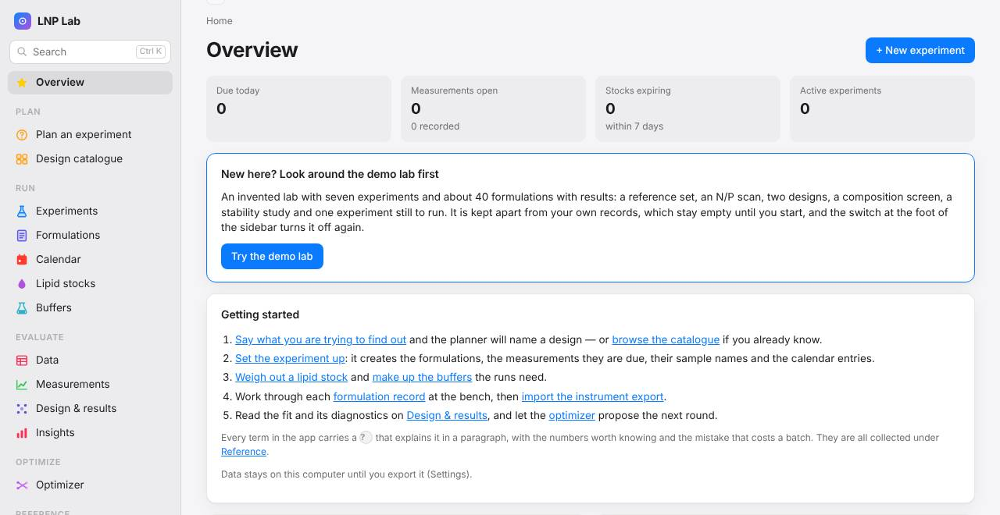

**What to look for**

- An empty lab opens on the **Overview** with a **Getting started** list. Each line links to the screen for that step.
- The sidebar is the workflow, top to bottom: **Plan**, **Run**, **Evaluate**, **Optimize**, then **Reference**
  (materials, explanations, settings).
- The foot of the sidebar shows how many experiments, formulations and measurements the lab holds, and the version
  you are running (`v0.13.0`, for example). Give the version when you report a problem.
- Every `?` next to a term opens a short explanation: what it is, the numbers worth knowing, and the mistake that
  costs a batch. **Reference** in the sidebar lists all of them.

**One view.** Every field shows; there is no simple or advanced switch any more (0.15). What is rarely needed folds
under one line where it sits, such as the DoE wizard's randomisation seed and plate wells.

**Light or dark.** **Auto** follows your computer; **Light** and **Dark** fix it.

**Finding your way back.** Under the title of every screen is a trail, such as *Plan › Plan an experiment ›
Questions › Work out what went wrong*. Each step is a link. The arrow to its left goes one step back, as do
Cmd+[ (Ctrl+[ on other systems) and the back button of a mouse; Cmd+] goes forward again.

## 2. Demo mode

Switch on **Demo mode** at the foot of the sidebar to fill the app with an invented lab. It holds a reference
experiment, an N/P scan, a factorial, a response surface, a composition screen, a four-week stability study on two
shelves and one experiment not yet run: about 40 formulations with about 100 results. The numbers come from a fixed
model with noise, so it is the same lab every time. The patterns in it are real ones that the statistics and the
optimizer can find.

Use it to:

- see what each screen shows once there is data;
- practise an import, a correction, a delete and its Undo, and an optimizer round without spending a batch;
- show the app to a colleague.

**What to look for**

- A purple **DEMO** label beside the name at the top of the sidebar. While it is there, everything you enter goes
  into the demo lab, not into yours.
- Your own records are untouched. Switch demo mode off and they are back exactly as you left them. The page reloads
  each time you switch.
- **Start over**, under the switch, throws the demo lab away and builds a fresh one.
- An export made while demo mode is on exports the demo lab. The demo never asks you for a backup.

## 3. Settings: your initials and the QC limits

Do this once, before your first experiment.

1. Open **Settings & export** (bottom of the sidebar).
2. Under **Defaults**, type your **Operator initials**. They are filled in on every stock, buffer, result and
   worksheet you create.
3. Check the defaults the experiment wizard and the bench record start from: FRR, quench factor, RNA working and
   final concentration, lipid stock molarity and volume, how many days a stock keeps (**Stock expiry**), the time of
   day calendar entries are exported at (**Reminder time**), and whether stability timepoints that fall on a weekend
   move to Monday.
4. Under **QC thresholds**, set your limits: **PDI max**, **Z-ave min** and **max** (nm), **EE min** (%), and the
   minimum DLS count rate. To stop checking one, untick **on** beside it; a field you empty to type a new number
   keeps the old limit until the new one is in.
5. Nothing to press: each setting is stored as you leave its field, and the heading says when it has saved.

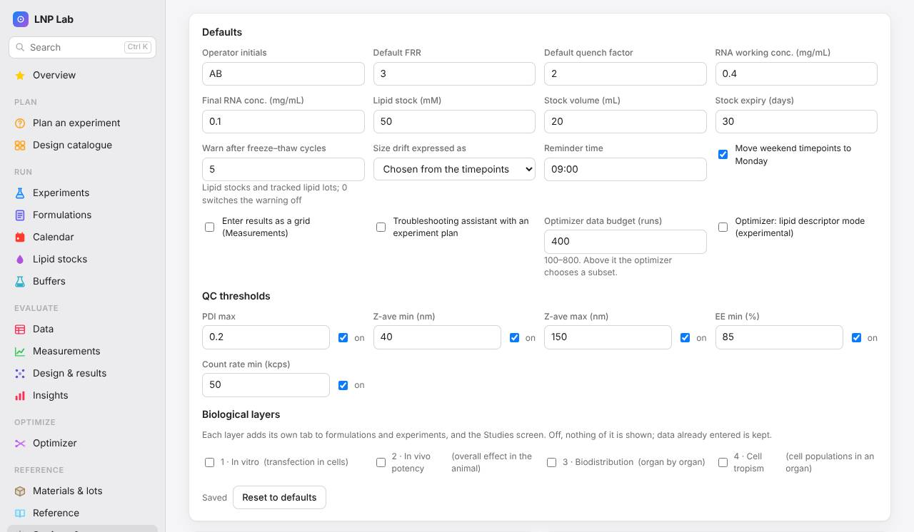

The QC limits are used everywhere: a result outside them is flagged when it is stored, listed under **Needs
attention** on the overview, drawn as dashed lines and shaded bands in the figures, and used to project the day a
stability sample will reach the limit. A flag is a warning, never a refusal.

**What to look for:** the notice **Settings saved**. Nothing is kept until you press the button.

**Reset to defaults** puts every setting back as shipped.

**Switches for the optional parts.** Everything below is off until you switch it on under **Settings & export**,
and with all of it off the app looks and works as before:

- **Enter results as a grid (Measurements)**: results typed into a table of an experiment's formulations (section 11).
- **Troubleshooting assistant with an experiment plan**: the planner's "Work out what went wrong" asks about the
  batch, weighs the causes and plans a small experiment (section 7).
- **Optimizer data budget** and **lipid descriptor mode**: see section 15.
- **Biological layers**: in vitro, in vivo potency, biodistribution and cell tropism, each on its own (section 17).
- **Import with Claude** and, in a personal build, **Claude insights**: see [Importing old spreadsheets with Claude](#importing-old-spreadsheets-with-claude-optional) and section 16. Both send
  your lab data to Anthropic when you use them; the switch says so the first time.

## 4. Materials and lots

**Materials & lots** holds what your formulations are made from. It has eight tabs. Almost everything on it can
be corrected later: click a row (or a lot) and it opens in place, with **Save** and **Cancel** (Escape also
cancels). Each lipid class has a colour and a letter, the same on every screen: **I** ionizable (blue),
**H** helper (orange), **S** sterol (green), **P** PEG-lipid (purple), **O** other (grey).

**Lipids & lots.** Sixteen common lipids ship with the app, with molecular weights and a class (ionizable, helper,
sterol, PEG). Under **Add lipid lot**:

1. Choose the lipid, type the **Lot number**, the **Supplier** and the **Purity %**.
2. Add **Received** and **Expiry** dates, the purity method and a link or path to the CoA.
3. Press **Add lot**.

**+ lot** on a lipid's row adds a lot to that lipid directly. Click a lot to correct its number, supplier, purity,
dates or CoA; a stock weighed from it points at the lot's record, so the correction shows there too, and a lot a
stock was weighed from cannot be deleted.

The lot is then offered on the stock weigh-in, so each stock records which lots went into it. The purity is
recorded, not corrected for: the weigh-in is grams = mmol × molecular weight, and the HPLC lipid content of the
stock is the check. A lipid that is not on the list can be added under **Add lipid**: a key
without spaces, a name, the class and the molecular weight.

**Compositions.** The registry of recipes by number. **#1** is the MC3 reference (DLin-MC3-DMA / DSPC /
cholesterol / DMG-PEG2000, 50 / 10 / 38.5 / 1.5, the Onpattro ratio). To add your own:

1. Under **New composition**, keep the suggested number or type your own, and add a **Synonym** you will recognise.
2. Choose up to six lipids and type their mol%. The running sum is shown beside the button.
3. Press **Add composition**. If the mol% do not total 100, the app asks before saving.

Click one of your compositions to change its name, lipids or mol%. Formulations read their recipe from the
registry, so before a recipe that formulations use is changed, the editor says how many and which, and the app
asks; **Save as new composition** leaves them as they are. Lipid stocks keep what they were weighed with, and
the earlier recipe is kept on the composition. The shipped #1 is read-only: open it and press **Edit a copy**.

**RNA lots.**

1. Type the **Lot number**, the **Construct / reporter**, the **Stock concentration** in mg/mL and how it was
   measured.
2. Press **Add RNA lot**. A lot number and a concentration are required.

Choosing this lot on a bench record fills in the stock concentration, so the RNA dilution is worked out for you.

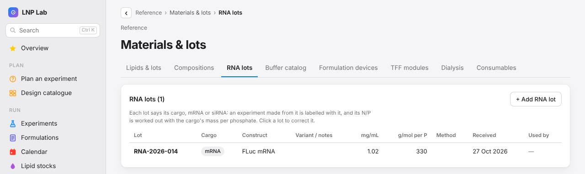

**Buffer catalog** lists standard buffer recipes and their roles. **Formulation devices** lists the instruments
and the mixers each takes; **TFF modules** one representative hollow-fibre module with the RNA load window it can
take; **Dialysis** a few example cassettes and float devices with their MWCO and volume range. In each of those
three you can add your own (**+ Add …**), edit a shipped entry (kept as your own version of it, with **Back to the
shipped version**), or hide one you do not have. A module or cassette a formulation record names keeps its name.
**Consumables** lists the filters.

**Archiving instead of deleting.** A lipid that a recipe or a stock uses, and a composition formulations read their
recipe from, cannot be deleted: their amounts and their place in a model depend on it. **Delete** then asks
whether to **archive** it instead. An archived one is hidden from the lists and from every picker, the records
that use it keep it and show it, and it is listed under **Archived** at the top of Materials & lots, with
**Restore**. A buffer lot that formulations name is archived the same way from the Buffers screen.

## 5. Weighing out a lipid stock

1. Open **Lipid stocks** and press **New stock**.
2. Choose the **Composition**, the **Total lipid** concentration (mM) and the **Volume** (mL). Date and operator are
   filled in, with the container, the filtration and the expiry date.
3. Each lipid has a card with the mass to weigh, in grams, large: mmol × molecular weight, with no correction for
   purity. Under it, choose the lot you are weighing from; the latest lot registered for that lipid is chosen for
   you.
4. Weigh each lipid and type what the balance says into **weighed**. The card shows how far you are off, in % and
   in mmol.
5. Once every lipid is weighed, step **2 · Add ethanol** shows how much ethanol to add, in grams and in mL, worked
   out from what you actually weighed. Step **3 · Result** gives the final volume, molarity and mg/mL.
6. Add notes if you need them and press **Create stock**. The stock gets the next number in its series: `Stock-001`,
   `Stock-002` … Until then what you typed is kept as a draft: leave the screen and come back, and it offers to
   continue it. Once the stock exists, later changes are stored as you make them.
7. **Print weigh-in worksheet** prints the targets with blank lines for the balance readings, the lot numbers and
   the ethanol.

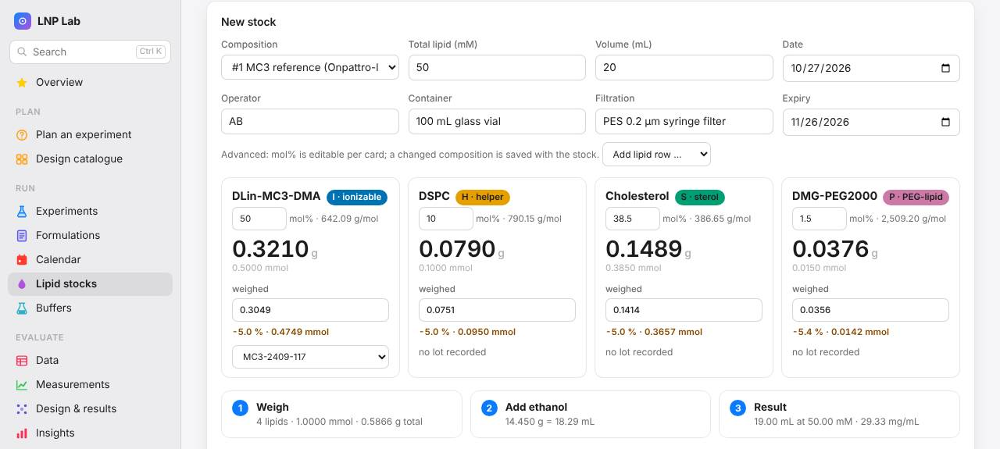

**What to look for**

- A deviation of more than 2 % is marked. The ethanol is worked out from what you weighed, so the molarity still
  comes out right; the molar ratio is what a large deviation changes.
- "no lot recorded" on a card means no lot of that lipid is registered under **Materials & lots**. Register the
  lots first if you want the stock to say which ones it was made from.
- **Mass fractions (for HPLC lipid content)** gives each lipid's share by weight, for
  checking the stock by HPLC.
- The mol% on each card can be changed, and **Add lipid row** adds a lipid. A stock with a
  changed recipe is saved with that recipe.
- The overview warns when a stock is within 7 days of its expiry.

## 6. Making up a buffer

1. Open **Buffers**. Either press **New buffer**, or press **Prepare** next to one of the **Common buffers** at the
   bottom of the screen.
2. Check the **Buffer system**, the **Target pH** and the **Buffer concentration**, and set them if they are not
   what you want. **Prepare** fills in the buffer's name and roles; make sure the three fields match the name before
   you go on.
3. Set the **Volume**, and any **NaCl** or **Sucrose**.
4. **Prepare with** chooses the reagents; **Recommended** uses an acid and its salt where both are known.
5. The **Recipe** gives grams of each reagent, then three steps: dissolve in about 80 % of the volume, make up to
   volume, check the pH. Below are the predicted pH, ionic strength and buffer capacity, and
   the speciation at that pH.
6. Under **Record**, check the name, date and who prepared it, and tick the roles the buffer will play:
   **Loading**, **Quench**, **Dialysis / TFF**, **Final / Storage**.
7. Press **Save lot**. It is named by its code, pH and date, e.g. `CIT50-pH4.0-20261031` (a second one that day gets `-2`), and also keeps a number `Buffer-001`, `Buffer-002` … that older records use. The code is suggested from the recipe and can be changed in **Code**. **Print recipe** gives the sheet for the bench.

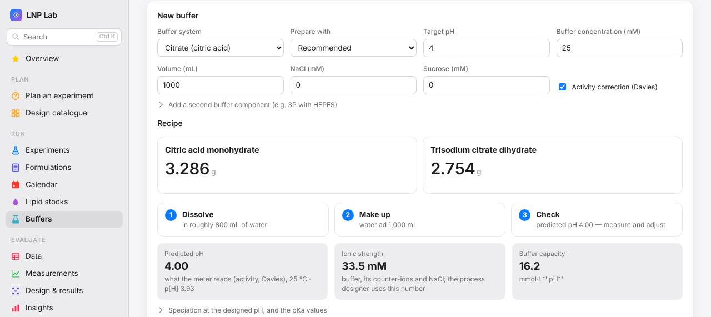

**What to look for**

- **Predicted pH** should equal your target. The calculation uses activity correction (Davies) at 25 °C. Measure
  the pH and record any adjustment in the notes.
- The roles decide where a lot is offered: a **loading** buffer appears as the RNA dilution buffer on the bench
  record, a **quench** buffer for pump 3, and so on.
- You can add a second buffer component (for example triphosphate with HEPES).
- **Prepared buffer lots** shows one row per buffer: how many lots, the newest, and its roles. Click a row for a
  table of all its lots (date, pH, volume, what is left, expiry, and how many batches used it). The tabs above
  filter by role. A lot that formulations name cannot be deleted; **Delete** then offers to archive it.

## 7. Planning an experiment

**Plan an experiment** helps when you are not sure what to run. It opens on three ways in:

- **Answer three questions:** what you are trying to do, how many batches you can run, and what you may change
  (process only, process and composition, or nothing).
- **Choose a design yourself:** the **Design catalogue**, every design the app can set up, grouped by the question
  it answers (the simple experiments, a single formulation, reference reproducibility and a comparison of
  compositions, come first), each with a small figure of its shape and the number of formulations it needs for the
  number of factors you pick. **More** under an entry says what it gives and what it will not tell you.
- **Work out what went wrong:** start from a symptom (particles larger than expected, PDI too high, encapsulation too
  low, results not reproducible, aggregation, low potency) and get the likely causes in order, each with the check
  that settles it before you spend a batch.

1. Press **Start the questions** and answer the three questions.
2. Read the recommendation and the four cards under it: **Why this and not something else**, **What will happen**,
   **What usually goes wrong**, and **Where you are starting from**, which is worked out from your own records.
3. Press **Set this up**. The experiment wizard (or the optimizer) opens with the design and the factors filled in,
   and says where they came from. Everything stays editable.

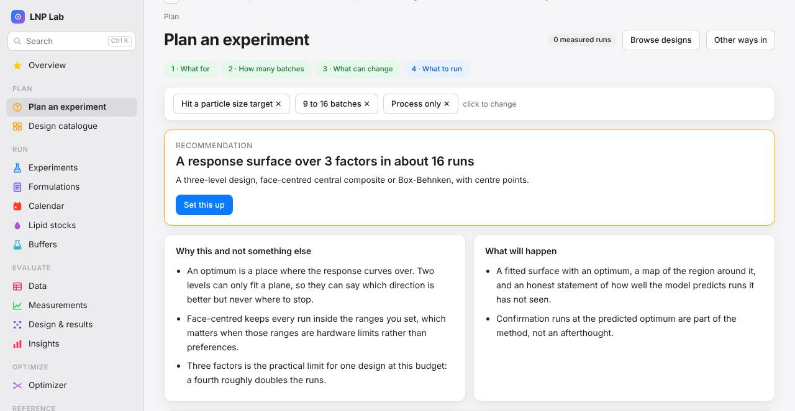

**The troubleshooting assistant** (with **Troubleshooting assistant with an experiment plan** switched on in
Settings) turns "Work out what went wrong" into three steps, each with Back:

1. **Context.** Opened from a formulation, it is filled in from its record: lipid, mixer, buffer and pH, FRR, total
   flow, PEG share, downstream. Correct anything and choose what is wrong: PDI too high, too large, too small, EE
   too low, or drift.
2. **Diagnosis.** The causes in order, each with its reason from your context ("FRR 2:1 is below the usual 3:1,
   which fits a high PDI"). Causes your context rules out are greyed, with why. Where you have similar batches
   (same lipid and mixer, nearby settings), it shows how they turned out.
3. **Experiment plan.** For the two or three likeliest causes, a small experiment: one factor at three levels
   plus your batch's setting as the control, or a 2 × 2 design over two causes with a centre point, each with what
   it should show. **Create as experiment** opens the experiment wizard with it filled in.

The thresholds the reasons use are general rules of thumb, not your lab's; they are listed in the open points.

**What to look for:** the planner never recommends more batches than you said you have. When the budget is too small
for what you asked, it says what it substituted and why. Click an answer at the top to change it.

## 8. Setting up each type of experiment

An experiment is the plan. When you create one, the app creates its formulations, the measurements each is due, the
sample names to use on the instrument, and the calendar entries.

**Every type, step by step**

1. Open **Experiments** and press **New experiment** (or **+ New experiment** on the overview).
2. Choose the type.
3. Fill in the form. Common to every type: a **Name**, the **Start** date (day 0, the production day), the
   **Composition**, the **Lipid stock lot** and **RNA lot** (or "choose later"), and the **RNA per batch** (mg), the RNA working concentration, FRR, quench factor, total flow, lipid stock molarity and how many
   formulations you make per day. Tick the **Measurements per batch** (DLS, zeta, EE, RNA content, potency).
4. Read **What will be created**: the number of formulations and their dates, the expected measurements, the
   measurement days, and an example sample name.
5. Press **Create experiment**. You land on the new experiment's page.

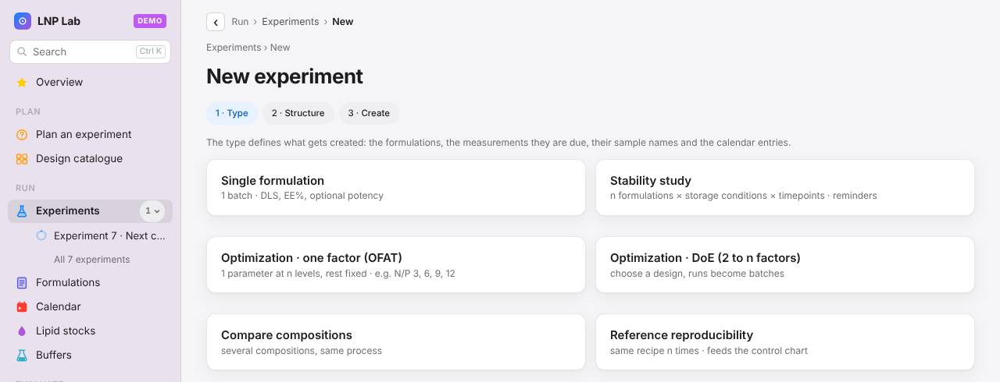

**Numbers.** Experiments are numbered `E1`, `E2` … and formulations inside them: `E3-F2` is the second formulation
of experiment 3, and its final product is measured as `E3-F2_final`. A number is never given out twice, even after
a delete. The example sample name in the wizard reads `E0-…` until the experiment is created; the real one uses the
experiment's own number.

**Single formulation.** One batch, measured once on the final product. The quickest way to see whether something
works at all.

**Reference reproducibility.** The same recipe made **Number of repeats** times (3 by default). The Results card
reports the batch-to-batch spread, and the batches feed the control chart in [Insights](#16-insights). Run one before
you believe any difference between two batches.

**Compare compositions.** Several compositions through one identical process. Under **Compositions to compare**,
add one line per arm with **+ Add composition**. Add the same composition twice and that arm is made twice: once
every arm has two or more batches, the Results card tests the arms against each other.

**Optimization · one factor (OFAT).** One **Factor** at several **Levels**, typed comma separated (for example N/P
`3, 6, 9, 12`). Everything else stays at the values above it.

**Stability study.**

1. Add each formulation to follow (**+ Add formulation**, one composition each).
2. Tick the **Storage conditions** (4 °C, 25 °C, −20 °C, 37 °C, RT).
3. Set the **Duration** and **Every n days**, or type your own **Custom timepoints**, which override the
   interval.
4. Choose the timepoints for potency and the tests to run at each timepoint.
5. The line **Timepoints:** lists what will be created. Check it before you press **Create experiment**.

Sample names carry the shelf and the day: `E6-F1_4C_T07` is formulation 1 of experiment 6 at 4 °C on day 7.

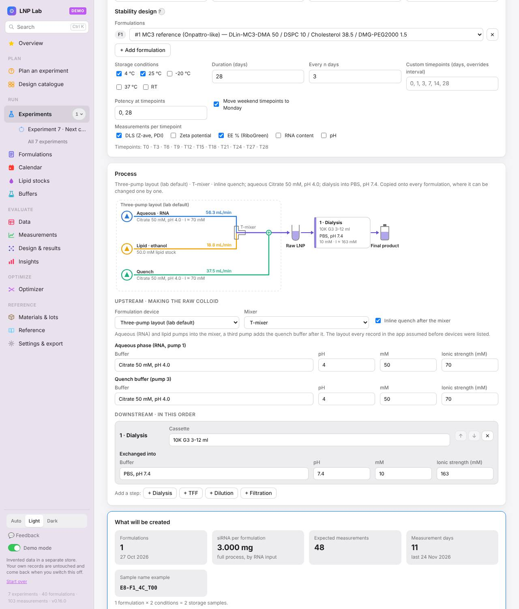

**DoE (design of experiments).**

1. Under **What are you optimizing?**, choose process parameters only, the lipid mixture only, or both together.
2. Add the **Factors**. Each has a name (letters, digits and underscores only), a unit, a **Low** and **High** level
   (and a centre, if it is not the midpoint), and the batch parameter it sets: N/P, FRR, total flow, quench factor,
   PEG or ionizable mol%, lipid stock molarity, RNA working concentration, or **record only** for something you set
   by hand, such as a temperature. A factor on a lipid's mol% has cholesterol take up the difference, so every recipe
   still totals 100 mol%.
3. Choose the **Design** (2- or 3-level full factorial, central composite face-centred, rotatable or inscribed,
   Box-Behnken, Plackett-Burman), the **Model to fit**, the **Centre points** and the **Replicates**. The line under
   them gives the number of runs, the model terms and the residual degrees of freedom. A warning appears when fewer
   than 3 degrees of freedom are left to judge the fit.
4. Tick the **Responses** and give each a goal: minimize, maximize, or a target value.
5. Create the experiment. The runs become formulations in their randomised order, so `F1` is the first run to make.

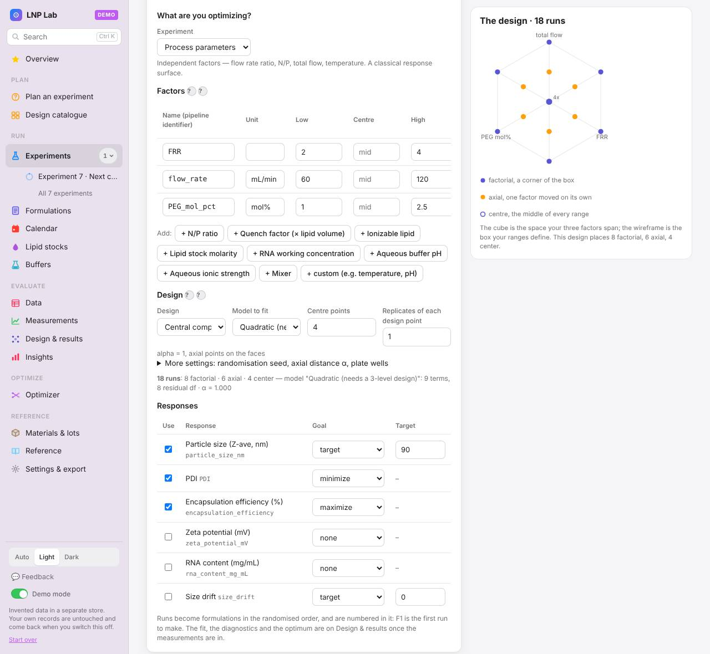

With a lipid mixture, you choose lipids and their mol% ranges instead of factors, and a mixture design (simplex
lattice, centroid, extreme vertices, D-optimal) with a run budget.

**Repeat as new.** On an experiment's page, **Repeat as new** opens the wizard filled in with that experiment's
settings, so you can change one thing and create it.

## 9. The experiment page

Open an experiment from **Experiments**, or from the list of open experiments under it in the sidebar.

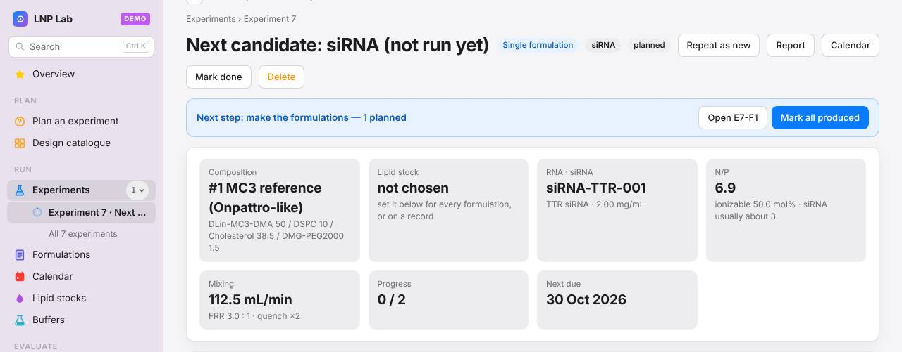

From top to bottom:

- **The buttons:** **Repeat as new**, **Design & results** (DoE and OFAT), **Report** (the notebook page, see
  [The notebook report](#the-notebook-report)), **Calendar**, **Mark done** or **Reopen**, and **Delete**.
- **Next step:** one line saying what is next (make the formulations, measure them, read the results) with the
  button that does it.
- **The summary:** composition, lipid stock, RNA lot, N/P, mixing, progress (measurements done of those expected),
  and the next due date.
- **Formulations**, with actions for all of them at once: **Mark all produced**, **Lipid stock for all** and **RNA
  lot for all**. The last two only change formulations still planned, and a stock only goes to formulations of the
  recipe it was made from.
  Each row links to its **Record** and to **Measure**.
- **Results**, once there is something measured (see [Reading the results](#12-reading-the-results)).
- **Expected measurements**, folded: every sample name, stage, test and due date, and whether it is done.

**The Formulations screen** lists every formulation under the experiment that planned it, a page at a time. Use the
filters **Still to make** and **Waiting for results**, or tick several formulations and press **Mark selected
produced** at the end of a bench day.

## 10. The bench record

Open a formulation with **Record** on its experiment page, or from **Formulations**. The record follows the batch
record: everything the app can work out is shown as a target, beside a field for what you actually did.

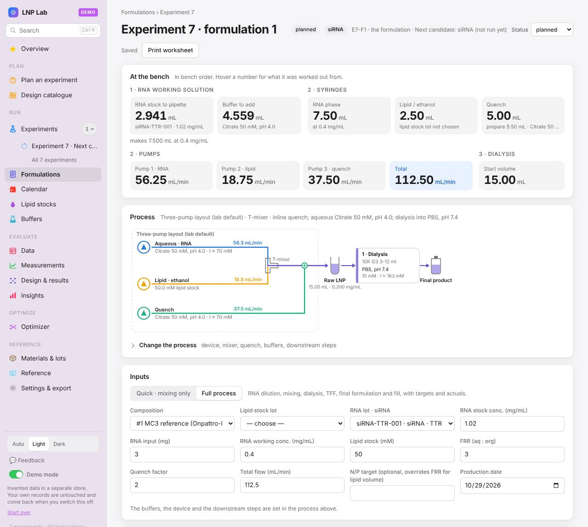

1. **At the bench** gives the numbers you set or measure out, in the order you need them: the RNA stock and buffer
   for the working solution, the three syringe volumes, the three pump flows and the total, and the dialysis start
   volume. Hover over a number to see what it was worked out from. A tile without a number says what it is waiting
   for ("choose an RNA lot").
2. Under **Inputs**, choose the lipid stock lot and the RNA lot (or type the RNA stock concentration), and check the
   RNA input, the working concentration, the buffers, FRR, quench factor and total flow. A
   **N/P target** sets the lipid volume from N/P instead of FRR.
3. Work through the steps. Each folds to one line with its state and key numbers; the one the batch is at opens:
   - **Step 1 · RNA dilution**
   - **Step 2 · LNP mixing**: pumps, primary product, run time, N/P
   - **Step 3 · Dialysis**: cassette, buffer, volumes, times, the IPC4 sample
   - **Step 4 · TFF concentration**: only when **Concentrate by TFF** is ticked
   - **Step 5 · Final formulation & filtration**: the two-step dilution to the final concentration, the filters,
     the IPC6 samples and the biosafety aliquot
   - **Step 6 · Fill & finish**: containers, count and fill volume
4. Set the **Status** at the top: planned → produced → measured → analyzed.
5. Everything you type is stored as you go: a field when you leave it, typing once you pause, and anything still
   open when you move to another screen. The header says "Saving …", then "Saved"; if it says **Not saved**, the
   browser refused the write, and a note at the top says what to do.
6. **Print worksheet** prints the record with the targets and blank lines, for a paper copy at the hood.

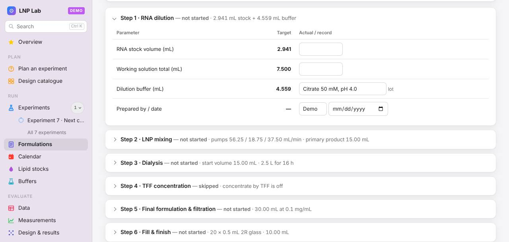

**What to look for**

- When a batch varies the composition (a DoE on PEG mol%, an optimizer suggestion), a note at the top gives the
  recipe actually to weigh out and which lipid took up the difference, with a link to weigh out a stock of exactly
  that recipe.
- At the bottom, the in-process controls (IPC4 to IPC6 and release) list the tests due at each stage.

**Process conditions.** Below the inputs, folded: what the process designer above does not record. Type the
ethanol share of the lipid phase, the temperature at mixing, the cryoprotectant and its concentration, and the
final RNA concentration (it shows the final formulation's target until you type one). The rest is shown with
where it comes from, not asked again: the loading buffer, its pH and strength,
the mixer and its type, the downstream method and target buffer, sterile filtration (all from the process), the
cargo (from the RNA lot), and the ionizable lipid and whether the recipe is PEG-free (from the composition). A
value outside what is sensible (an ethanol share of 150 %) is kept and marked. The heading also says where the
record came from: typed in, or imported, with the file and row.

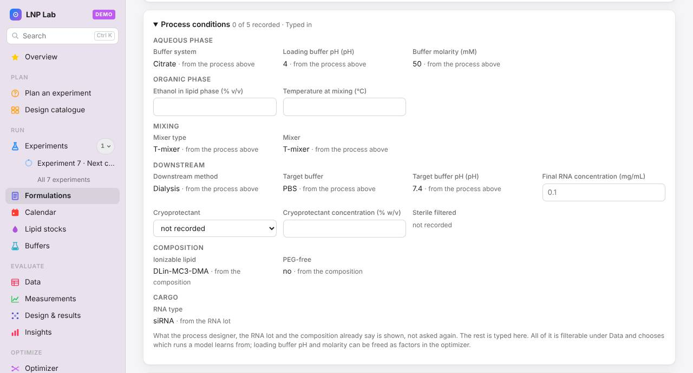

## 11. Measurements

### What is due

**Measurements** opens on **Due**: what is overdue, due today and coming in the next 7 days, one line per experiment
and stage, with the number of samples and the tests.

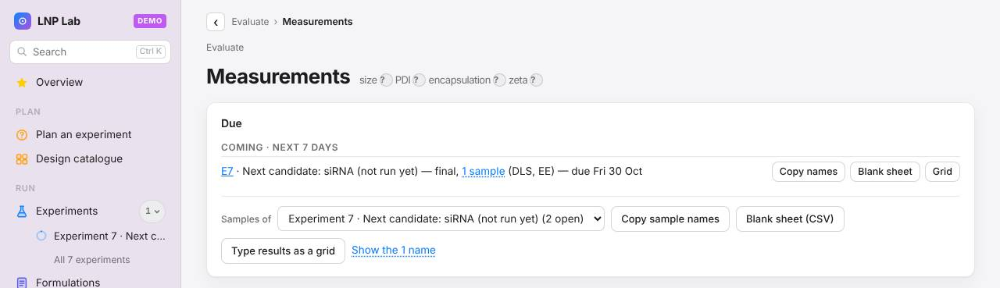

Each line has three buttons:

- **Copy names** copies the sample names, one per line, to paste into the instrument's sample list.
- **Blank sheet** downloads a CSV with one row per sample and a column for every test still due (size, PDI, zeta,
  EE, RNA content). Fill it in, or let the instrument fill it, and import it in one go.
- **Grid** opens a table to type the results in (see [Typing results](#typing-results-the-grid)).

The bar under it, **Samples of**, does the same for any experiment with open measurements.

### Naming samples on the instrument

Use the names the app gives, exactly: `E3-F2_final`, `E6-F1_4C_T07`. Then an export matches by itself.

**Runs of one vial** are averaged into one result when they carry the same name, or the app's name with a run
number after it (`E3-F2_final 1`, `E3-F2_final_2`, `E3-F2_final (3)`). A number at the end of any other name is part
of the name: `LNP-1` and `LNP-2`, or `Sample 6` and `Sample 9`, stay separate samples, and the preview says so. Under
a name the preview lists the rows it averaged; check the **n** column: it should be the number of runs per vial.

### Importing an instrument file

1. Under **Bring the results in**, press **Choose File** and pick the export (CSV or text).
2. Leave the type on **Detect from the columns**, or choose DLS, zeta, EE (RiboGreen) or RNA content.
3. Read the preview before anything is stored (see below).
4. Set the date measured (used only if the file gives none) and the operator, and press **Import selected**.

The importer takes files as instruments write them:

- UTF-16 (the Zetasizer default) or UTF-8, with or without a byte-order mark;
- comma, semicolon or tab separated, with decimal commas;
- lines of metadata above the header (file name, export date, operator);
- English or German column names (`Sample Name` or `Probenname`, `Z-Average (d.nm)` or `Z-Mittelwert (d.nm)`,
  `Zeta Potential (mV)` or `Zetapotential (mV)`), with units in the headers;
- summary rows such as `Mean`, `Std Dev`, `Mittelwert` and `Standardabweichung`, which are dropped;
- size and zeta records in one file, split apart;
- RiboGreen plates with an EE column, or with total and free RNA in µg/mL or ng/µL (EE is worked out); blanks and
  standards are left out.

Triplicate runs of a sample are averaged, and the runs are kept with the result.

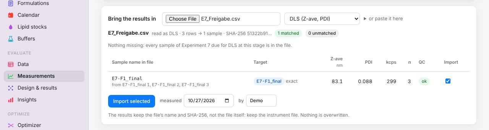

**What to look for in the preview**

- The line under the file name: how the file was read, how many rows became how many samples, and how many matched,
  did not match, or were refused.
- **Target** for each sample, with `exact` when the name matched an expected measurement.
- **Still missing from this file:** expected samples the file does not have. If exactly one row matched nothing and
  exactly one sample is missing, the row is set to that sample; change it if that is wrong.
- A row that matches nothing can be pointed at an open sample, sent to the inbox, or ignored.
- **QC**: a flag against your limits. A value no measurement can have (a PDI outside 0 to 1, an EE outside 0 to
  100 %, a negative size or concentration) is refused, with the reason.

### The evaluation after an import

Every import ends on its own evaluation: one sentence on what came in, tiles with the counts and the mean Z-average
and PDI, a figure per sample with every run and the QC limits, size against PDI when there are several samples, the
samples that need a look and why, and where each experiment it fed now stands. **Recent imports**, further down,
reopens the evaluation of an earlier import.

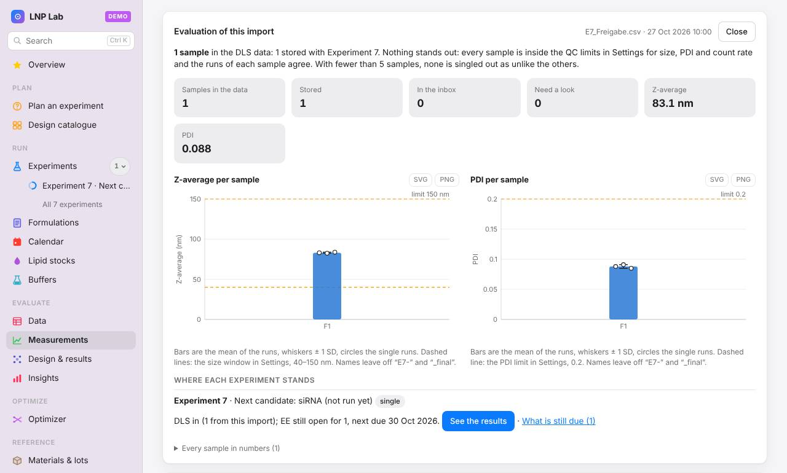

### Pasting from a spreadsheet

Open **or paste it here**, paste a block copied out of Excel or the instrument software (with its header row), and
press **Read what I pasted**. The same preview follows.

### Typing results: the grid

For results without an export worth the name (a plate reader's EE, a pH meter):

1. Press **Grid** on a due line, or **Type results as a grid** in the **Samples of** bar.
2. Type the numbers in. Tab and Enter go down a column. A column copied out of Excel and pasted into the first cell
   fills down, one line per sample in the order shown.
3. For DLS, **+ runs** shows a column for each of up to three runs per sample, so the result keeps its SD.
4. Check the date and operator and press **Save all**. Empty cells are skipped. A value that is refused stays in the
   grid with its reason; the others are stored.

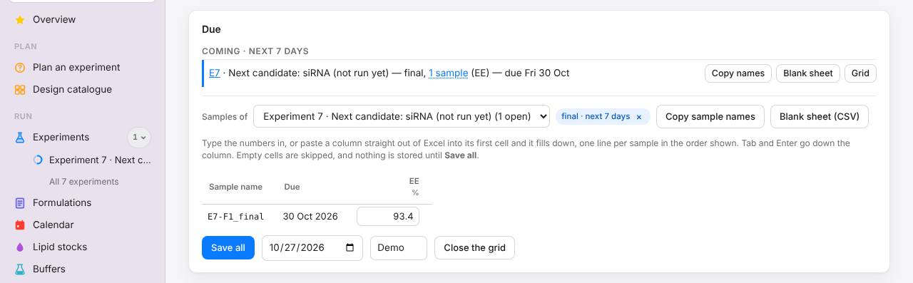

**The grid of an experiment** (with **Enter results as a grid** switched on in Settings): an **Enter results** card
on Measurements takes all of an experiment's results in one table.

1. Choose the experiment and the stage. Each formulation is a row (for a stability study, each formulation and
   shelf); tick the columns you measured (Z-ave, PDI, EE, zeta, RNA content).
2. Type as in Excel: Tab goes right, Enter goes down. Up to three replicates go in one cell, separated by `;`
   (`82; 85; 80`, decimal commas are fine); the mean ± SD shows under the cell. A block copied out of Excel is
   pasted from the cell you are in.
3. Orange means worth a look (outside a QC limit, a size under 10 nm) and is stored with a flag. Red means no
   measurement can have it (PDI over 1, EE over 100 %) and is not stored; the rest of the grid still is.
4. **Save all** stores the whole grid at once. **Undo** takes it back, with the due measurements opened again.

The import preview shows its values the same way, so an instrument file and a typed grid look alike.

**One result by hand:** under **Type one result**, choose the sample (or **Free entry**), type the values and press
**Save result**.

### The inbox

Rows that matched nothing and were sent to the inbox appear under **Unassigned imports**, with a count on
**Measurements** in the sidebar and a line on the overview. Point each at the sample it belongs to and press
**Assign**, or **Drop** it.

### Correcting a result

1. Open the result: from the **Results** list at the bottom of Measurements, from an import's evaluation, from a
   flagged result on the overview, or by clicking a Z-average in a stability table.
2. Press **Edit**.
3. Change the values, or the single runs (the mean follows the runs; clear every cell of a run to drop it).
4. Say **Why it is corrected**: typo, re-measured, wrong sample, wrong unit, or your own words.
5. Press **Save the correction**.

The old values are kept, with the reason and the date, under **Corrections** on the result.

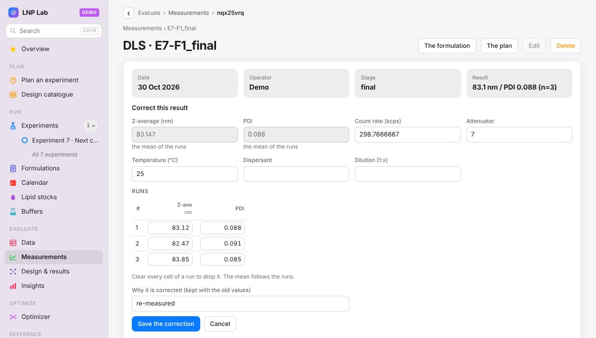

**Delete** on a result asks first, reopens the expected measurement, and cannot be undone: a deleted result does not
go to the trash. Correct a result rather than delete it.

### The results list

The **Results** card at the bottom of Measurements lists every stored result, newest first, 50 to a page. Filter it
by experiment, by test, by sample name, or to **flagged only**.

### Keep your instrument files

The app keeps each file's name and fingerprint (SHA-256) with the results that came from it, not the file itself.
Keep the exports in your own folder. A file whose results are already stored is known by its fingerprint: the
preview says when it was imported and ticks nothing, and it goes in again only after **Import it again** and a yes.

## 12. Reading the results

### The Results card

Once the first result is in, the experiment page shows a **Results** card, read the way you would read a GraphPad
project: statements first, then figures, then the data table.

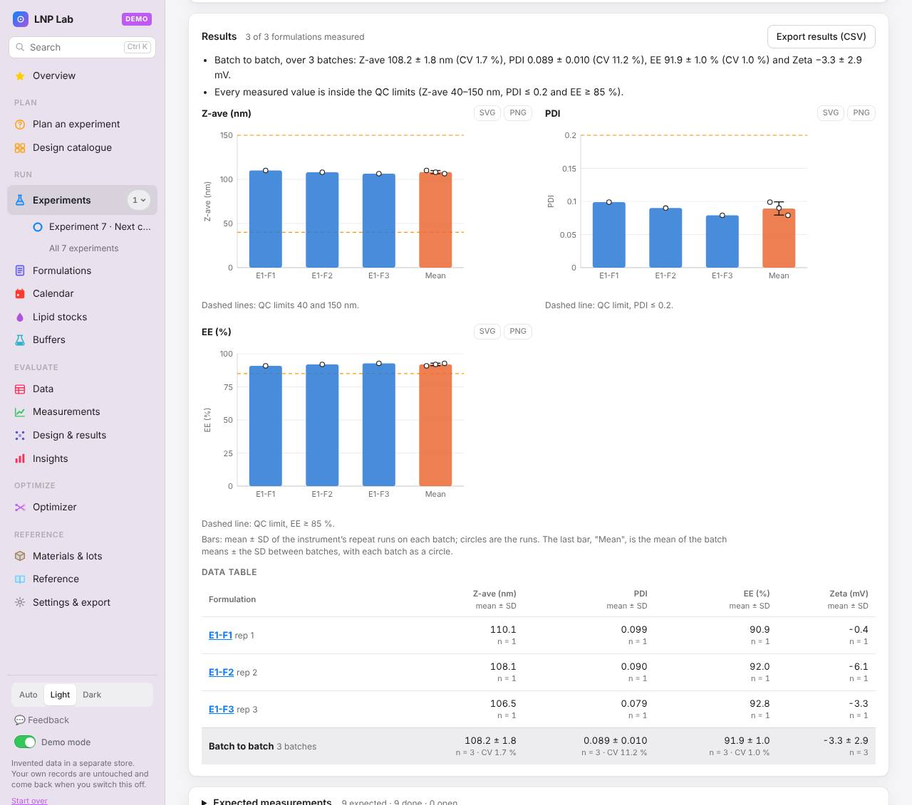

**The data table** gives, per formulation and response, mean ± SD with n under it, and the CV where it means
something. **n counts different things in different rows.** For a single batch, the SD is the spread of the
instrument's repeat runs on that one sample: how precisely it was measured, not how much a second batch would differ.
The batch-to-batch row, and arms made more than once, give the SD between batches. The card says which in words.

**The statements** depend on the type of experiment:

- **Reference and repeats:** the batch-to-batch mean ± SD and CV for each response.
- **Comparison:** each arm against the first. Once every arm has two or more batches: Welch's t test for two arms,
  one-way ANOVA with Holm–Šídák comparisons for more, on the batch means.
- **OFAT:** where each response is lowest and highest, and a figure of the response against the level.
- **Stability:** one table with the days as columns and the change from T0; a slope per formulation and shelf, in
  nm per day with its 95 % confidence interval (from three timepoints on); the day the line would reach the QC limit;
  and which sample gets there first. The projection holds only while the drift stays linear, and the card says so.
- **DoE:** a pointer to [Design & results](#14-the-doe-screen-design--results), where the model is.
- **Every type:** the values outside the QC limits, by name.

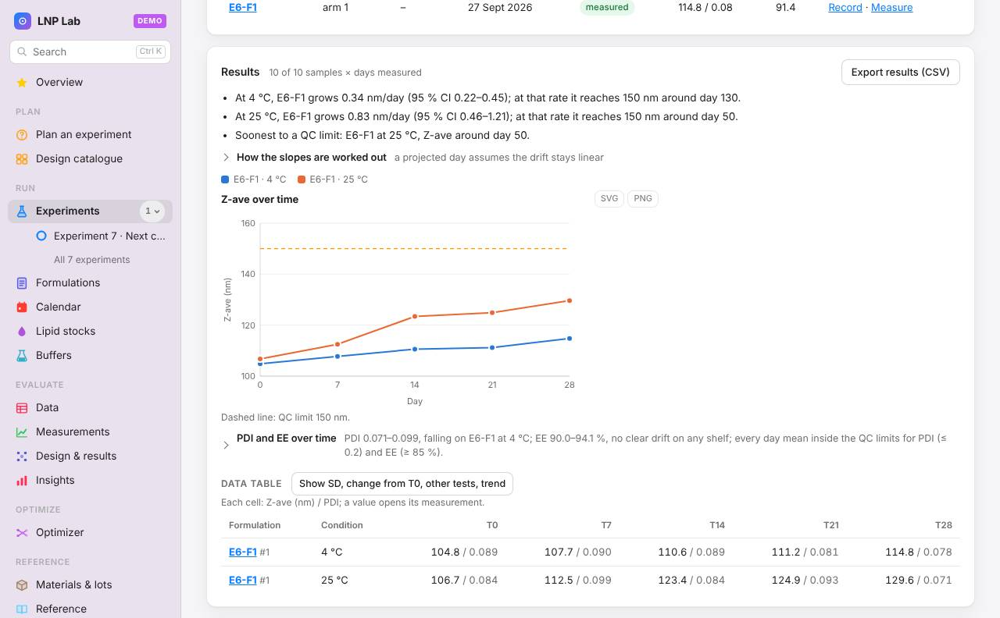

**Figures**: bars with the SD and every run as a circle, or lines over time for stability. **SVG** and **PNG** above
each figure save it: SVG for a slide or a paper (it stays sharp and can be edited), PNG for a quick message.
**Export results (CSV)** saves the data table.

### The notebook report

**Report**, on an experiment page or on the DoE screen, opens one printable page for the lab notebook: the header
(type, dates, operator, composition, lots, process), the plan, the statistics, the data table, numbered figures and
lines for the operator's and reviewer's signatures. The DoE report adds the recommendation, what drives each
response, the coefficients and the diagnostic plots. Print it, or choose **Save as PDF** in the print dialog. It is
printed in light colours whatever the screen theme.

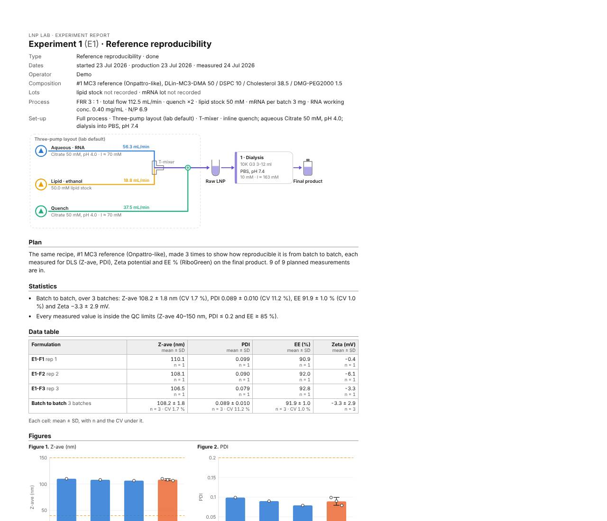

**What to look for:** the report opens in a new window. If nothing happens, your browser has blocked the pop-up:
allow pop-ups for this address.

## 13. Data: every formulation at once

**Data** (under Evaluate) lists every formulation the lab has made, with filters like a shop's, so a question such
as "everything with ALC-0315", "everything in citrate at pH 4" or "everything PEG-free" is one click.

- **On the left, the filters.** Composition (ionizable, helper, sterol and PEG lipid, with **PEG-free**), process
  (buffer system, loading pH, mixer type, downstream), context (cargo, experiment, period, operator), origin
  (typed in, instrument file, imported, and the import itself), and what was measured (DLS, RiboGreen, stability,
  biological data, size and PDI ranges). The number in brackets is how many formulations you would have with that
  value ticked, the other filters as they are. Ticking two values of one filter means either; ticking two kinds
  of measurement means both. The search box at the top takes anything the app's search knows: an experiment,
  a formulation, a sample name, a lot, a stock.
- **Above, the numbers** of the selection: formulations, experiments, the period, and the median size, PDI and EE.
- **In the middle, the table.** Click a heading to sort, a row to open the formulation. **Columns** chooses what
  is shown; the choice is remembered.
- **On the right, the distributions:** runs per ionizable lipid, size, PDI and runs per month. A click on a bar
  filters to it. Under them, **Completeness**: for each field, the share of the selection that has it (green over
  90 %, amber 50 to 90 %, red under 50 %). A click lists the formulations that lack it, to fill them in.

Every filter is in the address of the page: **Back** undoes the last click, and a bookmark keeps the selection.

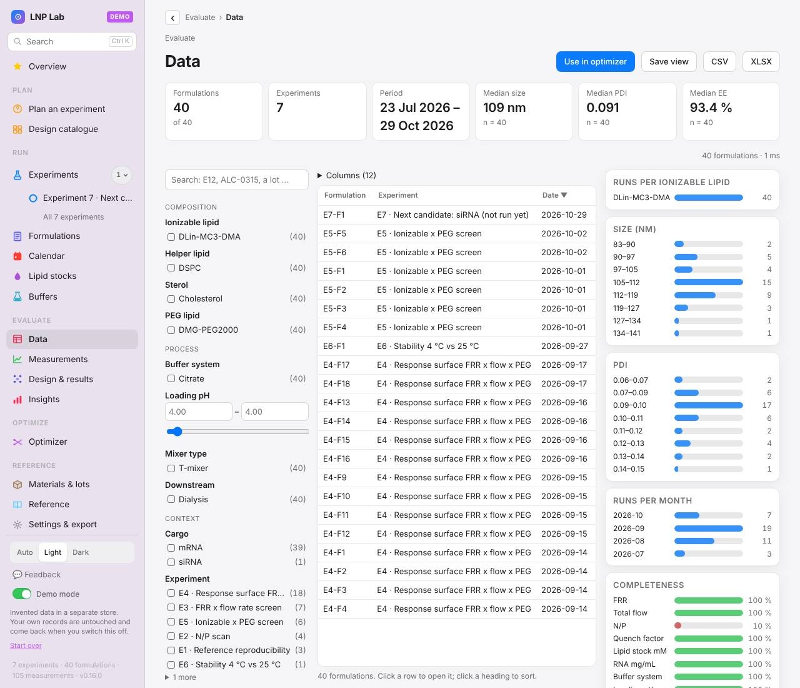

**With the selection:**

- **Use in optimizer** opens the optimizer with exactly these formulations as its data, said in words at the top
  ("ALC-0315, Citrate, 412 formulations").
- **CSV** and **XLSX** save the selection with every column, the source columns included.
- **Save view** names the selection. Saved views are in the sidebar under **Data**; with two or more, **Compare
  two views** puts their numbers and distributions side by side.

## 14. The DoE screen (Design & results)

Open **Design & results** in the sidebar, or the button on a DoE or OFAT experiment, and choose the experiment.

**1. Best balance of all responses.** The screen leads with one recommended setting: where the fitted models together
come closest to every goal at once. The table gives each factor's setting, each response's predicted value with its
scatter (how far one batch will land from the prediction), the goal and a score from 0 to 1; then the overall score
and the best run you made, for comparison.

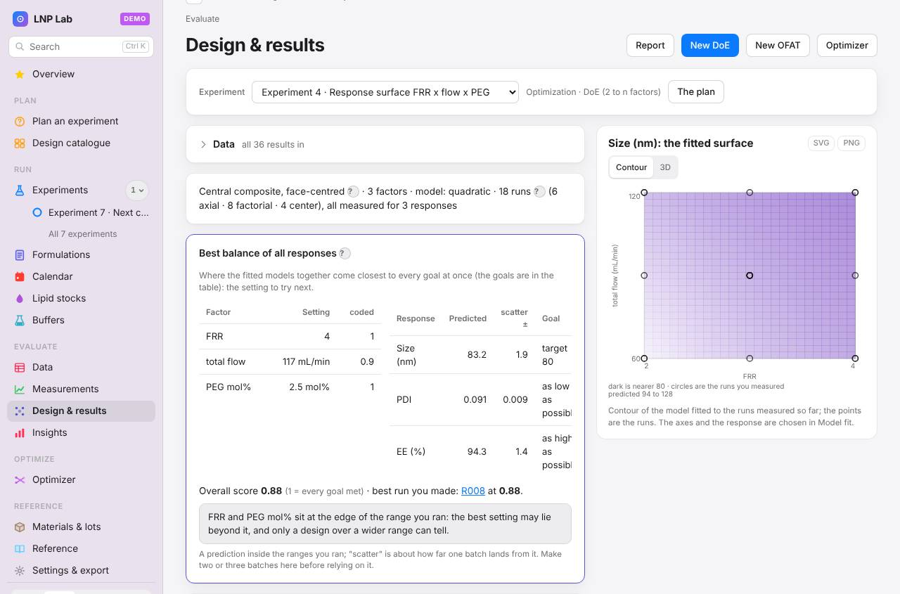

**What to look for**

- A note that a factor **sits at the edge of the range you ran**: the best setting may lie beyond it, and only a
  follow-up design with a wider range can tell you.
- If no setting can meet a goal, the card says which response cannot be satisfied.
- Make two or three batches at the recommended setting before you rely on it.

**2. What drives each response.** One sentence per response: which factors move it, by how much across the range you
ran, and whether two of them interact. A **predicted R²** below 0.5 means the model is a lead to check, not a finding.
Click a response to plot it.

**3. Is this fit any good?** One sentence on whether to believe the fit, beside the one plot that shows why: a run
that stands out, lack of fit against the replicates, too many terms for the runs, a funnel or a curve in the
residuals, residuals that are not normal. "The fit looks sound" means none of these was found.

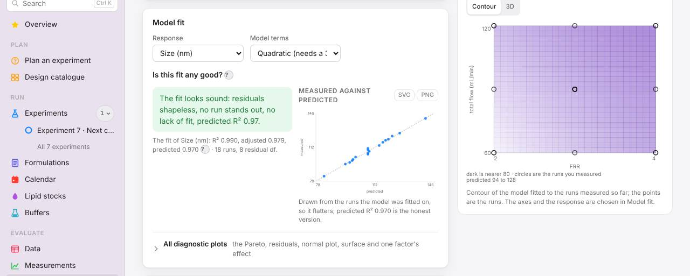

**All diagnostic plots** unfolds the rest: which terms are real (a Pareto of |t|), residuals against fitted, the
normal plot, the fitted surface (as a contour map or in 3D, against any two factors) and the effect of one factor,
optionally split by a second. Each can be saved as SVG or PNG. **Model terms** switches between main effects,
interactions and a quadratic model.

**Folded underneath:** **Design and runs** (the run table in standard or run order, with the measured responses, to
export as PDF or CSV or copy into a spreadsheet), **Coefficients and the one-response optimum**, and **Take the data
elsewhere** (the design and the measured data as CSV), for R, Python or any statistics package.

For an OFAT experiment, the screen shows the dose response: the response against the level of the factor.

## 15. The optimizer

The optimizer reads every measured formulation in the lab, fits a model of each response, says how far the model
can be trusted, and proposes the next runs. It needs data:

- about 8 measured runs with the factors varied for a first model,
- about 15 before the model's quality can be tested honestly,
- 20 or more for a predicted optimum and the map.

The overview tells you where you stand ("39 measured runs. Enough for a response surface …").

### A round, step by step

1. Open **Optimizer**.
2. **What counts as a good batch:** for each response, tick it and choose its goal (hit a target, stay in a band,
   as low as possible, as high as possible), the range and a weight. The scores are combined so that one
   unacceptable result sinks the whole batch, however good the rest is. Under **Hard limits**, add any response that
   must stay below or above a value: settings likely to break a hard limit are never proposed.
3. **What you are willing to change:** tick the factors. Only factors that actually varied in your batches can be
   judged; the others are listed as **held constant**. The search ranges start at the span you have run, widened by
   a quarter; type your own if your rig cannot go there.
4. If you vary lipid mol%, leave one lipid class unticked to take up the slack, normally cholesterol. The note under
   the table names the class that balances the recipe.
5. Press **Fit model and suggest runs**.

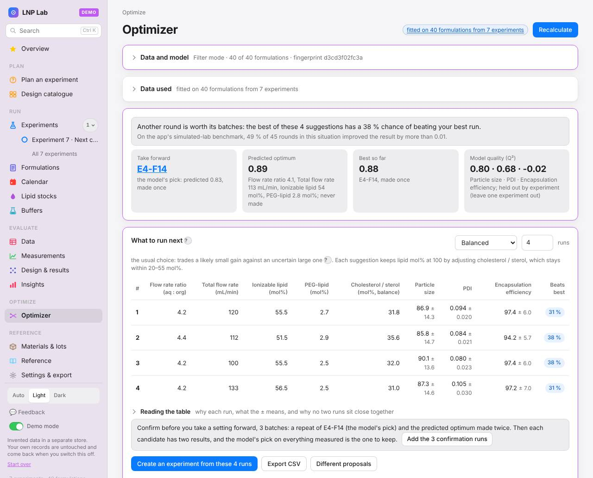

### Reading the result

- **The tiles:** how many settings to run next, the **Best so far** (the best overall score among the runs made,
  and which run), the chance that the top suggestion beats it, and the **Model quality** (Q², per response,
  measured on whole experiments held out from the fit). A Q² near or below 0 means the model predicts that response
  no better than its average.
- **What to run next:** one row per suggested setting, with the predicted responses and their 95 % intervals, the
  chance the run beats the best so far. Why each was chosen (a likely gain, or information where the model is
  unsure) is under **Reading the table**. Choose the mode (mostly exploit, balanced, mostly explore, half and half) and the number of runs;
  **Different proposals** draws another set.
- **Add a repeat of …:** when the best run so far has never been repeated, every suggestion is measured against one
  measurement that may have been lucky. One repeat settles it.
- Folded underneath, each with a line saying what it found: **Where the model thinks the optimum is**, **Goals and
  factors** (the setup; it opens at the top instead when a goal needs fixing or nothing could be suggested), **Model
  quality**, **The map** (the predicted score over any two factors, with the runs made, the suggestions and a box to
  try any setting), **What drives what**, **Is this worth the batches?** (how the optimizer's runs compare with the
  ones before them) and **The runs behind all of this**.

### Data and model: what the optimizer rests on

The **Data and model** panel at the top says what the model is built on. It is open until the first fit; after
that its line reads, for example, "Filter mode · 412 of 9,800 formulations · fingerprint 3f9a0c…", and a click
opens the rest.

- **Lipid and mixer:** the optimizer works on one ionizable lipid and one mixer type at a time, because both change
  the physics. The combination with most measured runs is preselected; formulations without a mixer type count as
  "mixer not recorded". A selection handed over from **Data** (Use in optimizer) replaces this choice.
- **Lipid mode:** **Filter** (one model per lipid, the default), **Categorical lipid kernel** (every lipid's runs,
  with how alike the lipids behave learned from the results; from two lipids with at least 8 runs each, and only
  for a lipid with runs of its own) or **Auto**, which compares the available modes by cross-validated Q² and
  says which it chose against what. **Lipid descriptors** is experimental: switch it on under Settings, enter the
  descriptors under Materials > Lipids; it opens from about 20 lipids.
- **Data:** how many formulations reach the model, and under **Where the rest went** why the others do not. Above
  the data budget (Settings, 400 by default, 100–800) the optimizer chooses a subset in four steps: runs outside
  the search range, runs whose measurement is not to be believed (an impossible value, a count rate too low),
  replicates merged into one point at their mean (their scatter still sets the noise), and a space-filling choice
  that prefers good and recent runs. **Why these data?** lists every formulation with its reason.
- **Free factors**, with "about 5 × k runs are needed" for k free factors, and a map of the runs on the two
  factors that matter most: used in colour, left out in grey, suggestions as stars.
- **Fingerprint:** every fit and every round made from it records the data used (ids and a hash of the values),
  the setup, the seed, the versions and the fitted model. **Reproduce** fits again from it and says whether the
  suggestions come out the same. The fingerprint is printed in the experiment report of an ML round.

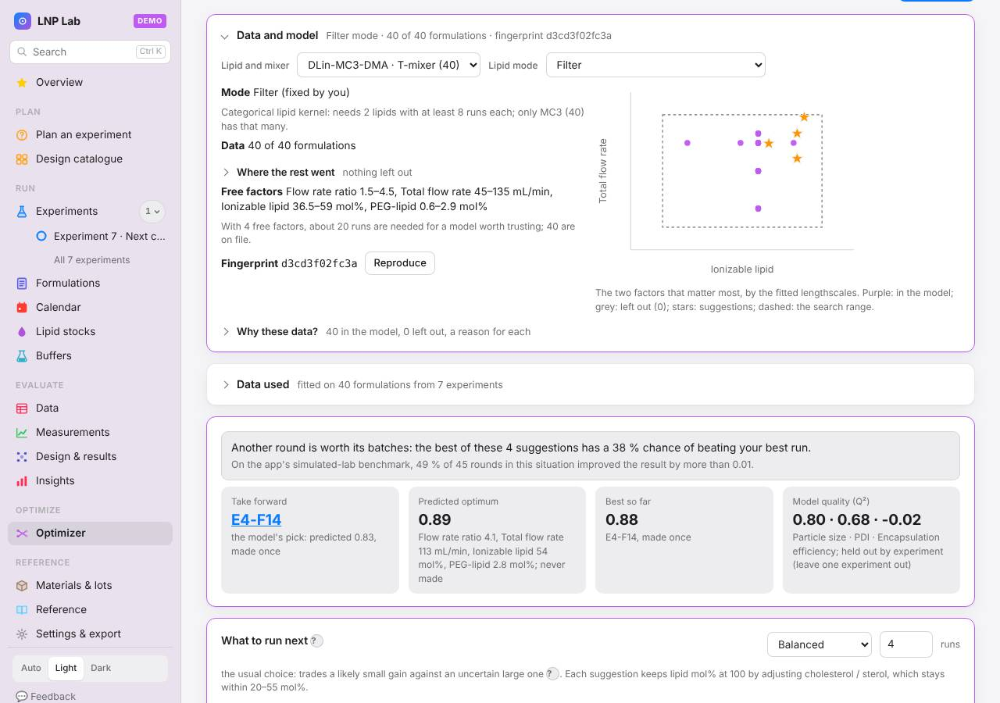

**Prediction against measurement** (a fold further down, once a suggested formulation is measured) holds every
result against the 95 % interval the optimizer gave for it: about 95 % should fall inside. It shows the share per
response, a scatter of predicted against measured, and the course over the rounds.

### Making the suggestions

1. Press **Create an experiment from these runs**. The app creates a new experiment with one planned formulation per
   suggestion. A suggestion that changes the recipe is registered as a new composition.
2. Make and measure them like any other experiment.
3. The experiment page then shows **What the model expected** beside what was measured. A result outside the
   predicted interval is not a failure: it shows where the model was wrong, which is the most useful run of the
   round.
4. Back on **Optimizer**, press **Recalculate** for the next round.

**What to look for:** if a suggestion would need a lipid at a negative or impossible mol%, the app asks before it
creates the experiment. Answer no, then untick one lipid class (see step 4 above) or narrow the ranges.

### When to stop

Each round costs batches, and the gain per round shrinks. The screen tells you when another round is unlikely to help
and suggests confirming the best candidates instead. What lies behind that advice, from simulated campaigns with the
app's own code (`npm run campaign`):

- Most of the gain comes in the first 20 or so runs. After that, a round mostly tightens the result by about the
  size of the batch-to-batch noise.
- When even the best suggestion has under about a 10 % chance to beat the best run so far, another round of four
  batches pays off about one time in six.
- The single best measurement is often a lucky one. Before you take a setting forward, make the best one or two
  candidates two or three times and compare their means.

## 16. Insights

**Insights** looks across experiments at one response at a time.

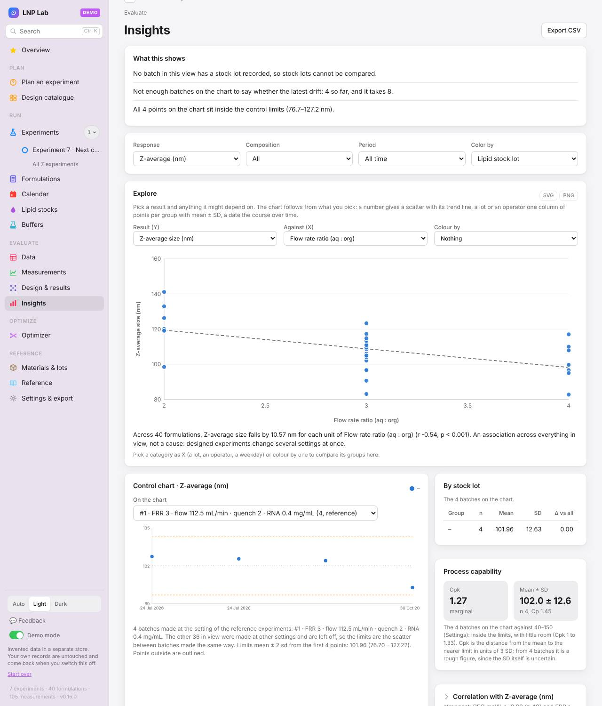

1. **What this shows** says what it found, in up to three sentences: the clearest difference between stock lots or
   operators among batches made at the same settings, with its 95 % interval and the batch-to-batch SD of repeats
   (or that there are too few such batches to tell); drift in the latest batches on the chart; and points outside
   the control limits.
2. Choose the **Response**, the **Composition**, the **Period**, and **Color by** (lipid stock lot, operator,
   experiment, composition, experiment type).
3. **Control chart:** the batches of one setting over time, by default the one your reference experiments repeat
   (else the one made most often), with limits at the mean ± 2 SD of the first 20 points. Points outside are
   outlined. **On the chart** picks another repeated setting, or every batch, whose limits then include the changes
   your designed experiments made on purpose.
4. **By …** gives n, mean, SD and the difference from the mean per group, for the batches on the chart.
   **Correlation** gives the direction of each process factor's association with the response; it is not proof of
   cause, so confirm it with a designed experiment.
5. **Export CSV** saves the batches in view, each with the setting it was made at.

**What to look for:** lots can only be compared when the formulations have their lipid stock lot recorded (on the
bench record, or with **Lipid stock for all** on the experiment page), and when both lots were made at the same
settings: repeats of one recipe on each lot, as a reference experiment makes them.

**A report from Claude** (personal build only, with **Settings › Claude insights** switched on): the newest report
Claude saved through the LNP Lab MCP server sits at the top, with when it was written and from how many
formulations. Each finding names the app's analysis it came from and links to its formulations. Once more than 20
formulations have been added since, it says **Report out of date, regenerate it in Claude**; a new one is made in
Claude, never by the app. Claude then reads your lab data, which is sent to Anthropic.

## 17. Biological studies (optional)

For transfection in cells and for animal studies. Nothing of it shows until a layer is switched on under
**Settings & export › Biological layers**:

- **1 In vitro:** transfection in cells (cell line, dose per well, time point; luciferase, positive cells, MFI,
  viability).
- **2 In vivo potency:** the overall effect in the animal (strain, route, dose in mg/kg, time point; total
  bioluminescence, serum protein).
- **3 Biodistribution:** the signal per organ. Liver is on by default; spleen, lung, kidney, heart, lymph nodes and
  the injection site are added in the study.
- **4 Cell tropism:** cell populations in an organ (method, marker panel; share of positive cells and MFI).

With a layer on, **Studies** appears in the sidebar, and every formulation and experiment gets a tab per layer
with its results.

**A study** holds one in-vitro or in-vivo experiment: its groups (each a formulation), the **reference**
formulation that ran alongside (your lab standard), optional negative controls (PBS, empty LNP) and the animal
licence number. Then:

1. **Enter values** in a grid, one line per well or animal (a column pasted out of Excel fills down), or
   **Plate reader**: a plate grid or a long table as exported, with the plate layout saying which group is in which
   well. For in-vivo layers, **IVIS images** reads a Living Image export folder (below).
2. **Results** shows each group against the reference: every well or animal as a point, the geometric mean with
   its 95 % interval, and the reference as a line at 1-fold. The raw values are always kept; what is compared is
   log10(value / reference mean), after subtracting the negative control when there is one. Each group is tested
   against the reference on the log values (Welch's test, corrected for the number of groups); the fold change and
   its interval are always shown, and a star only when the interval excludes 1-fold. Organs come as small charts
   side by side with their ratios (liver : spleen per animal), tropism as stacked shares.
3. **Across studies** puts physicochemistry against the normalised signal (size against liver signal, say), using
   only normalised values, so studies with different absolute levels can be compared.

A study without a reference is stored with a warning: its values cannot be normalised or compared.

**IVIS images.** Choose an exported folder (the one with `AnalyzedClickInfo.txt`, `ClickInfo.txt`,
`luminescent.TIF` and `photograph.TIF`). The app finds the mice on the photograph, numbers them from left to right,
and measures each mouse's total flux (photons per second, independent of exposure and binning, with the
instrument's own calibration), a liver region and the background. It warns about saturated pixels; exposure and
binning are for you to set right at the instrument. Each mouse is suggested an animal of the study (from the
Living Image comment or the study plan) for you to confirm. Every number can be checked in the overlay and
corrected (move the liver region, override a flux, leave a mouse out); corrections are logged. The original
image files stay where they are; the app records their path and checksum. How well the automatic values agree
with hand-drawn regions is in [docs/BLI-BENCHMARK.md](BLI-BENCHMARK.md).

**Animal study** in the design catalogue (with an in-vivo layer on) shows how a small animal study would be
planned from the optimizer, but it is locked: it cannot be created. Its notice on animal welfare (3R, the licence
obligation, the user's responsibility) is a placeholder for the lab's own text.

## 18. The calendar

**Calendar** is filled from your experiments: production days (green), preparation the day before (buffers and the
RNA dilution), measurement days and stability timepoints (blue), and stock expiry (orange). Done items are struck
through. Each item opens what it refers to.

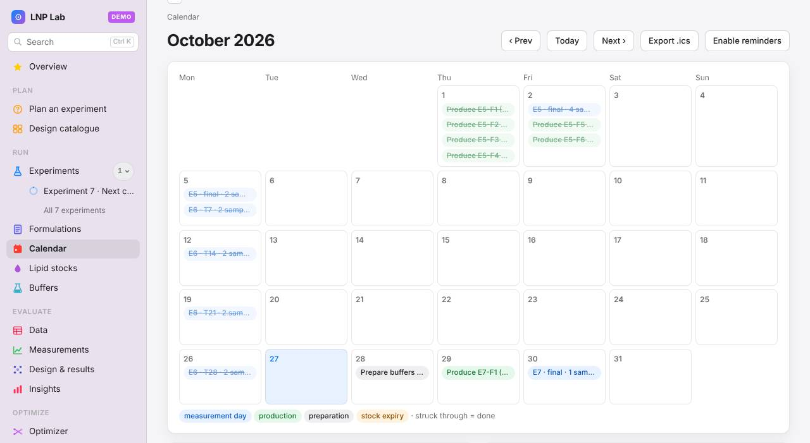

- **‹ Prev**, **Today** and **Next ›** move between months. **Upcoming** and **Overdue** are listed under the month.
- **Add manual event** adds your own entry. Its ✕ removes it at once.
- **Export .ics** saves the open events as a calendar file for the macOS Calendar or Outlook, each at the reminder
  time set in Settings, with an alert 30 minutes before.
- **Enable reminders** asks your browser for permission to notify you. You then get one notification on a day with
  events, when the app's overview opens.

## 19. Search

The **Search** box at the top of the sidebar finds experiments, formulations, sample names, lipid stocks, buffers,
RNA lots and compositions as you type. **Ctrl K** (on a Mac **⌘K**) jumps to it from anywhere. Use ↑ and ↓ to move,
Enter to open and Esc to close.

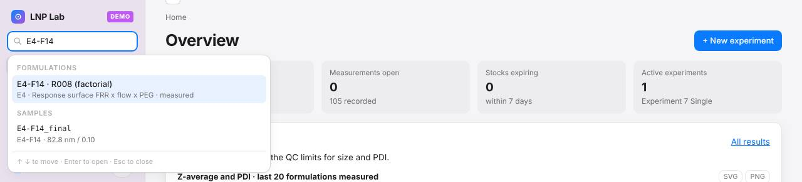

## 20. Deleting, Undo and the trash

**Deleting an experiment** (with its formulations), **a lipid stock** or **a buffer lot** happens at once, without a
question. The notice that follows has an **Undo** button; it goes when you open another screen.

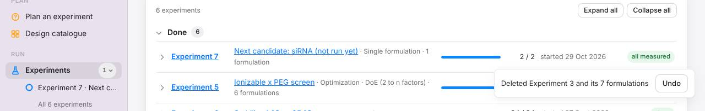

Noticed too late? Everything deleted in the last 30 days is under **Settings & export › Recently deleted**.
**Restore** puts back exactly what was removed, where it was.

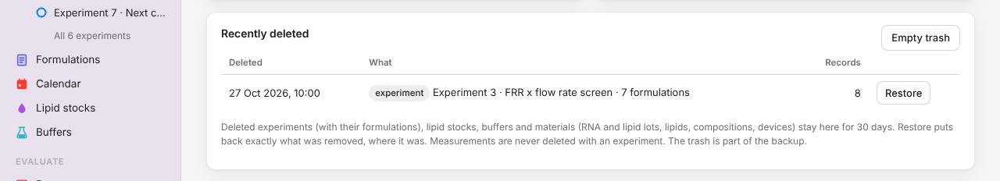

**What to look for**

- The results of a deleted experiment are not deleted with it. They wait in case you restore the experiment. Once
  it has left the trash (after 30 days, or when you empty the trash), the overview lists them under **Needs
  attention** as results that belong to a formulation that no longer exists, so you can keep or delete them.
- The deleted experiment's number is never given to a new one, so its tube labels and instrument files can never be
  matched to another experiment.
- **Empty trash** erases the trash for good, after a question. Some deletes have no trash at all: a single result
  (it asks first), an inbox row (**Drop**) and a manual calendar entry.
- The trash is part of the backup.

## 21. Backups

Everything lives in one browser on one computer. A new computer, a cleared browser or a broken profile takes all of
it with it. Export a backup at least once a week, and keep the file somewhere other than this computer.

**The reminder.** When there is no backup yet, or the last one is a week old, and something has changed since, the
overview says so under **Needs attention**, with **Export now** and **Remind me tomorrow**.

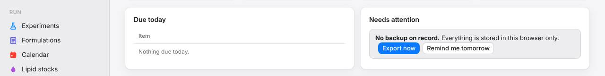

**Exporting**

1. Open **Settings & export**.
2. Under **Backup & restore**, press **Export everything (JSON)**. A file named `lnp-lab-export-<date>.json` is
   downloaded.
3. Move it to your lab drive, a USB stick or wherever your lab keeps data.

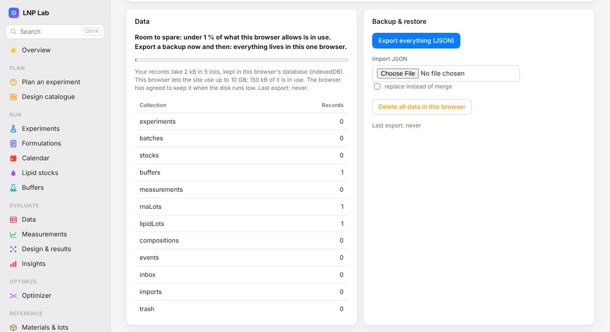

**What is in a backup:** every record of the lab you are in: experiments, formulations and their bench records,
results with their runs and their correction history, lipid stocks, buffer lots, lipid and RNA lots, your own
compositions and lipids, calendar entries you added, the inbox and the import log, your settings and QC limits, the
trash, and the counters that keep numbers from being given out twice.

**What is not in it**

- **Your instrument files.** Only their names and fingerprints are kept; keep the files yourself.
- **This browser's preferences:** light or dark, the folded sidebar list, reminders.
- **The other lab.** An export from your own lab does not contain the demo lab, and an export made in demo mode
  contains only the demo lab.
- **The reference data that ships with the app** (the 16 lipids, the reference composition, the buffer catalogue,
  the pKa table). It comes with the app itself.

**Restoring**

1. On the computer you are restoring to, open the app (demo mode off).
2. **Settings & export › Import JSON**, choose the file.
3. By default the backup is **merged**: each record in the file replaces the record with the same id, and records
   that are only here are kept. Tick **replace instead of merge** to replace each collection the file holds with
   the file's version; the app asks first.
4. The notice says how many records were imported in how many collections, and what was skipped.

Numbers never go backwards: after restoring an older backup in the same browser, the next experiment still gets a
number no earlier experiment has had. On a new computer, numbering carries on from the backup, so restore the most
recent one.

## 22. Where your data lives

- Your records are kept in your **browser's own database** (IndexedDB) on this computer, under the address you
  open the app at, `http://localhost:8787`. Opening the app at another address or port (for example
  `127.0.0.1:8787`, or `localhost:8788` when the usual port was busy) shows an **empty lab**: your records are
  still there, under the usual address.
- Each browser and each browser profile has its own lab. Chrome and Safari on the same Mac do not share records.
  The macOS app has its own lab too, separate from any browser.
- A private or incognito window keeps nothing after it is closed.
- **Clearing your browsing data** for this site ("cookies and other site data", "website data") **deletes every
  record**. So can a browser that runs short of disk space, unless it has agreed to keep the site's data;
  **Settings › Data** says whether it has.
- **Settings › Data** also shows how much the records take, how much the browser allows and when you last exported.
- One window or tab at a time changes a lab. Another one opened on the same lab only shows your records, and says
  so at the top of every screen; press **Use this window instead** to make your changes there, and the first one
  then only shows them. Closing a window hands the changes to the one left open. Your own lab and the demo are
  separate: a window on each changes its own.
- **Delete all data in this browser** (Settings) erases the lab you are in, after two questions.
  In demo mode it erases only the demo lab.

If the browser cannot store a change (the disk is full, or the browser blocks storage in a private window), a note
appears at the top of the screen and stays there until saving works again. It says what happened to the change:
either it was undone, so nothing is half-saved, or it exists only in this window for now. Then:

1. Export a backup under **Settings** straight away.
2. Free space: empty the trash in Settings, or free disk space on the computer.
3. Press **Try again** on the note. If the change was undone, do it again instead: on the screen that made it, the
   note names the button to press (**Create experiment**, **Import selected**).

### Importing old spreadsheets with Claude (optional)

Without Claude, the same tables can be prepared by hand or in any spreadsheet and checked with one command;
[docs/HISTORICAL-DATA.md](HISTORICAL-DATA.md) describes the format, with a worked example.

**Settings › Claude › Import with Claude** is for bringing old Excel sheets in through Claude Desktop or Claude
Code and the LNP Lab MCP server (set up as `mcp/README.md` says). Claude reads and maps the sheets; the server
checks every row with the app's own rules and shows a quality report; nothing is written until you approve it, and
in the macOS app only while LNP Lab is closed (quit it first). Switched on the first time, it says what it means:
Claude reads your lab data, and it is sent to Anthropic; the server itself sends nothing over the network.

- Rows that fail a check go to **Quarantine**, which appears in the sidebar while any wait there. Open one, fill in
  or correct what is missing, and press **Check again**: it runs the same check, and a row that passes joins its
  import.
- **Settings › Imports** lists every import of tables, with what of it is in the lab. **Undo import** moves all of
  it into **Recently deleted**, from where **Restore** puts it back.
- If the macOS app was open while the server wrote anyway, its next save is refused with a note to reload: reload,
  and make your last change again. Nothing of the import is lost.

## 23. When something goes wrong

- **The page stays blank.** After about three seconds it says **LNP Lab did not start** and lists the file or the
  error behind it, with what to do. Usually a reload fixes it; after an update, a hard reload (**Cmd+Shift+R**).
  If not, send the message to whoever maintains the app.
- **"Your records could not be opened"**: the browser's database did not answer. Nothing is lost. Reload the page.
- **A notice starting with "Error:"** is a fault in the app. Note what you did just before, and send it with the
  version from the foot of the sidebar.
- **A screen says "Screen … failed"**: the same, for one screen. The rest of the app still works.
- **Results do not match on import**: check the sample names against **Copy names**; point unmatched rows at their
  samples in the preview or the inbox.

---

*Maintainers: the pictures are made by `node tests/usability/guide-shots.mjs`, which rebuilds them from the app as it
is. See `docs/HANDOVER.md`.*
